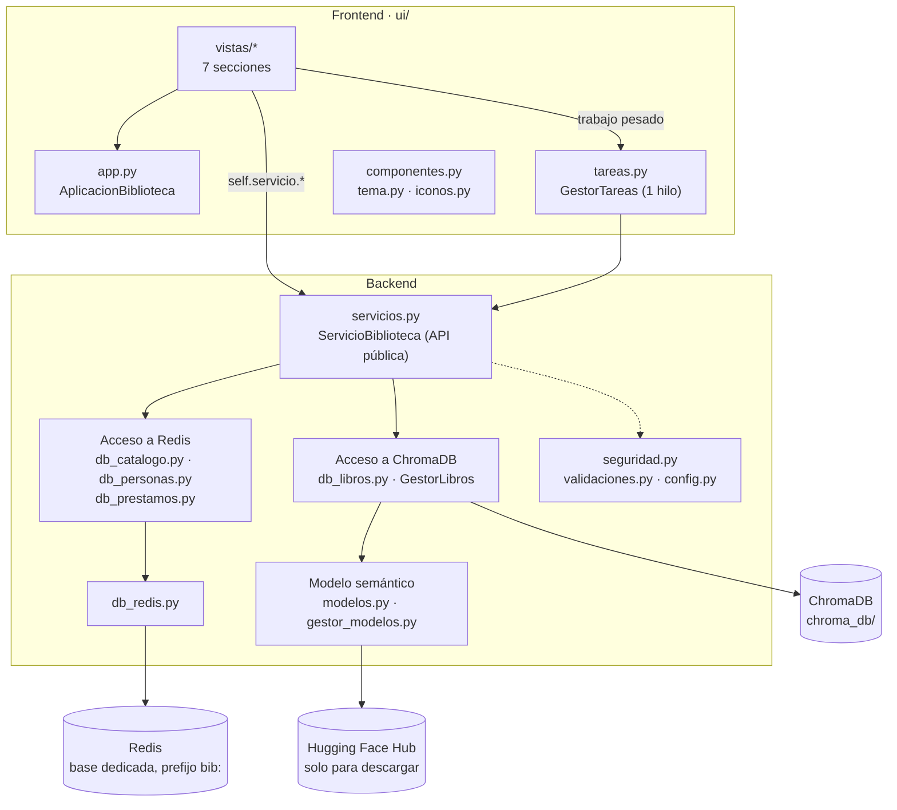
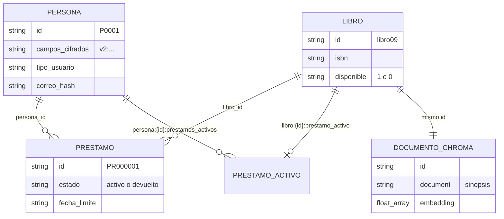

# Arquitectura

Documento de referencia sobre la estructura del sistema: capas, módulos, dependencias, modelo de datos en Redis y ChromaDB, consistencia y concurrencia. Los flujos detallados de cada funcionalidad están en [FLUJOS_DATOS.md](FLUJOS_DATOS.md) y el contrato entre interfaz y backend, en [INTEGRACION.md](../INTEGRACION.md).

## 1. Visión general

Módulos transversales: `config.py` (configuración y validación), `validaciones.py` (reglas de datos), `seguridad.py` (cifrado y control de acceso), `db_redis.py` (conexión, llaves y bitácora) y `gestor_modelos.py` (descarga y validación de modelos).

### Dependencias entre módulos (sin ciclos)

| Módulo | Depende de |
|---|---|
| `config` | — (importa `modelos` y `seguridad` solo dentro de `validar()`) |
| `validaciones` | — |
| `seguridad` | config, cryptography |
| `modelos` | config, sentence-transformers (carga perezosa), gestor_modelos (dentro de funciones) |
| `gestor_modelos` | config, modelos, huggingface_hub |
| `db_redis` | config, redis |
| `db_catalogo` | db_redis, validaciones |
| `db_personas` | db_redis, seguridad, validaciones |
| `db_prestamos` | config, db_redis |
| `db_libros` | config, modelos, validaciones, chromadb |
| `portadas` | config, validaciones, Pillow (Open Library por `urllib`) |
| `servicios` | todos los `db_*`, modelos, gestor_modelos, portadas, seguridad, validaciones, config |
| `ui/*` | **Solo** la API pública de `ServicioBiblioteca` (recibida como `app.servicio`) y `servicios.describir_error`; constantes de `config`; funciones puras de `validaciones` y `seguridad` (listas cerradas, normalización, enmascaramiento, aviso) |
| `modelo_simulado` | validaciones |
| `demo_interfaz` | servicios, modelo_simulado, fakeredis, chromadb, ui.app |
| `main` | config, servicios, db_redis, seguridad, ui.app |

## 2. Separación frontend / backend

| Capa | Módulos | Responsabilidad |
|---|---|---|
| Interfaz gráfica | `ui/` | Presentación, navegación, formularios y avisos. No accede a bases de datos. |
| Lógica de negocio | `servicios.py` (`ServicioBiblioteca`) | Reglas de préstamos, compensación Redis ↔ Chroma, estadísticas y la **API pública para la interfaz**. |
| Acceso a Redis | `db_redis.py`, `db_catalogo.py`, `db_personas.py`, `db_prestamos.py` | Llaves, transacciones y cifrado de campos. |
| Acceso a ChromaDB | `db_libros.py` | Documentos, metadatos, embeddings y consultas vectoriales. |
| Modelo semántico | `modelos.py`, `gestor_modelos.py` | Carga, descarga, revisión fijada y validación. |
| Seguridad y validaciones | `seguridad.py` (cifrado, `ControlAcceso`), `validaciones.py`, `config.py` | Reglas de datos, autenticación y configuración. |

- **Contrato**: la interfaz solo llama a los métodos públicos de `ServicioBiblioteca` documentados en [INTEGRACION.md](../INTEGRACION.md). Los errores se traducen a mensajes con `servicios.describir_error`, de modo que `ui/` no depende de `redis`, `chromadb` ni del modelo.
- **Verificación automática**: `tests/test_arquitectura.py` analiza el código de `ui/`. Falla si importa módulos de bases de datos o del modelo, si usa atributos internos del servicio (`r`, `catalogo`, `indice`, `personas`, `prestamos`, `actividad`, `llaves`) o si llama a un método que no existe en la API. También comprueba que el backend no importe `ui` ni `tkinter`.
- **Hilos**: lo que toca ChromaDB o el modelo se ejecuta en el hilo trabajador de `ui/tareas.py`. Las operaciones que solo usan Redis pueden llamarse desde la interfaz (columna «Hilo» de INTEGRACION.md).
- **Desarrollo aislado del frontend**: `demo_interfaz.py` construye el mismo `ServicioBiblioteca` sobre fakeredis, ChromaDB en memoria y `modelo_simulado.py`, sin tocar datos reales.

## 3. Responsabilidad de cada base de datos

| Dato | Redis | ChromaDB |
|---|---|---|
| Identificador del libro | ✔ fuente de verdad | ✔ `ids` |
| Metadatos del libro | ✔ fuente de verdad | ✔ copia en `metadatas` |
| Sinopsis | — | ✔ `documents` |
| Embedding | — | ✔ |
| Disponibilidad | ✔ fuente de verdad; cambia de forma atómica en préstamos | ✔ copia sincronizada |
| Personas | ✔ cifradas | — |
| Préstamos e historial | ✔ | — |
| Bitácora de actividad | ✔ | — |
| Portadas | — (archivos `portadas/{id}.jpg` y `{id}.json`) | — |

Los resultados de la búsqueda semántica se **enriquecen siempre con Redis** (`ServicioBiblioteca.buscar_libros`). Aunque la copia de metadatos en Chroma quedara atrasada, el estado mostrado y el filtro «solo disponibles» son correctos.

## 4. Modelo de datos en Redis

Base dedicada (`REDIS_DB`, por defecto 2) y prefijo `REDIS_PREFIJO` (por defecto `bib:`). Todas las llaves se construyen con la clase `db_redis.Llaves`. Al arrancar, `preparar_base` verifica que la base no contenga llaves ajenas y marca `bib:meta:esquema = 2`.

| Llave (sin el prefijo) | Tipo | Contenido | Método de `Llaves` |
|---|---|---|---|
| `meta:esquema` | STRING | Versión del esquema (`2`). | `esquema` |
| `libros` | SET | Ids de todos los libros. | `libros` |
| `libro:{id}` | HASH | isbn, titulo, autor, anio, editorial, genero, tema, idioma, pasta, paginas, calificacion, disponible (`1`/`0`), id, fecha_alta, fecha_actualizacion. | `libro(id)` |
| `idx:isbn:{isbn}` | STRING | Id del libro que usa ese ISBN normalizado. | `idx_isbn(isbn)` |
| `libro:{id}:prestamo_activo` | STRING | Id del préstamo activo; como máximo uno por libro. | `prestamo_activo_libro(id)` |
| `persona:contador` | STRING | Generador de ids `P0001`, `P0002`… | `persona_contador` |
| `personas` | SET | Ids de todas las personas. | `personas` |
| `persona:{id}` | HASH | 13 campos cifrados (`v2:` + AES-GCM), `tipo_usuario` en claro, `id`, `correo_hash`, `acepta_aviso_privacidad`, `fecha_aviso`, `fecha_registro` y `fecha_actualizacion`. | `persona(id)` |
| `idx:correo:{hmac}` | STRING | Id de la persona dueña del correo (índice ciego). | `idx_correo(hash)` |
| `persona:{id}:prestamos_activos` | SET | Préstamos activos de la persona. | `prestamos_activos_persona(id)` |
| `persona:{id}:historial` | ZSET | Todos sus préstamos; el *score* es la fecha (timestamp). | `historial_persona(id)` |
| `prestamo:contador` | STRING | Generador de ids `PR000001`… | `prestamo_contador` |
| `prestamo:{id}` | HASH | id, persona_id, libro_id, titulo, autor, fecha_prestamo, fecha_limite, fecha_devolucion, estado (`activo`/`devuelto`). | `prestamo(id)` |
| `prestamos:activos` | SET | Préstamos activos de toda la biblioteca. | `prestamos_activos` |
| `prestamos:todos` | ZSET | Todos los préstamos, ordenados por fecha. | `prestamos_todos` |
| `personas_con_prestamo` | SET | Personas con al menos un préstamo activo. | `personas_con_prestamo` |
| `actividad` | LIST | Últimos 100 eventos (`MAX_EVENTOS_ACTIVIDAD`) en JSON `{fecha, tipo, descripcion, refs}`, solo con identificadores. | `actividad` |
| `sync:pendientes` | SET | Libros cuya copia en Chroma quedó pendiente tras un fallo. | `sync_pendientes` |

Los estados «vencido» de un préstamo y la edad de una persona **no se almacenan**: se derivan al leer (`GestorPrestamos._enriquecer` y `validaciones.calcular_edad`).

## 5. Modelo de datos en ChromaDB

- **Cliente**: `chromadb.PersistentClient(path=CHROMA_PATH)`, con telemetría desactivada (`Settings(anonymized_telemetry=False)`).
- **Colecciones**: una por modelo, con el nombre `libros_<modelo>` que genera `modelos.nombre_coleccion`; por ejemplo, `libros_qwen3_embedding_0_6b`. Se crean con `configuration={"hnsw": {"space": "cosine"}}` y `metadata={"modelo": <repositorio>, "dimensiones": <dim>}`.
- **Registros**: `ids` es el id del libro; `documents`, la sinopsis; `metadatas`, los 12 campos de `validaciones.CAMPOS_METADATOS_LIBRO`; y `embeddings`, vectores calculados por la aplicación, porque `embedding_function=None`.
- **Similitud**: Chroma devuelve una distancia coseno y el sistema la convierte a `similitud = 1 − distancia` (`GestorLibros.buscar`).
- **Modelo activo**: se guarda en `modelo_activo.txt`, junto a la carpeta de Chroma. Cambiar de modelo reindexa en una colección nueva y conserva la anterior.

## 6. Modelo semántico

Resumen; el detalle completo está en [MODELO_SEMANTICO.md](MODELO_SEMANTICO.md).

| Parámetro | Valor |
|---|---|
| Modelo | `Qwen/Qwen3-Embedding-0.6B` (1024 dimensiones, *last-token pooling*). |
| Revisión | `97b0c614be4d77ee51c0cef4e5f07c00f9eb65b3`, fijada en `modelos.MODELOS`. |
| Precisión | float16 en GPU (`model_kwargs={"dtype": torch.float16}`); float32 en CPU. |
| Documentos | Sinopsis sin instrucción. |
| Consultas | `Instruct: Given a web search query, retrieve relevant passages that answer the query\nQuery:` |
| Longitud máxima | 512 tokens (`max_tokens`). |
| Carga | Siempre desde la carpeta local de la revisión fijada (`gestor_modelos.ruta_local`); nunca descarga de forma implícita. |

## 7. Consistencia entre Redis y ChromaDB

No existe una transacción distribuida entre Redis y ChromaDB. Cada operación sigue el patrón **validar → escribir en Chroma → confirmar en Redis** y, si algo falla, **compensa** el paso anterior:

| Operación | Secuencia | Compensación ante fallo |
|---|---|---|
| Alta | Validar campos e id e ISBN únicos → embedding y `upsert` en Chroma → transacción `WATCH` en Redis. | Se borra el documento de Chroma. |
| Lote | Validar fila por fila (duplicados en el archivo y en la base) → embeddings en lotes de 32 → `MULTI` en Redis. | Se borran de Chroma los ids insertados. |
| Actualización | Copia previa (con embedding) → `update` en Chroma (re-embedding solo si cambia la sinopsis) → transacción en Redis. | Se restaura la copia en Chroma. |
| Eliminación | Se bloquea si hay un préstamo activo → copia previa → borrado en Chroma → borrado en Redis. | Se reinserta la copia en Chroma. |
| Préstamo | Transacción `WATCH/MULTI` en Redis → copia de la disponibilidad a Chroma. | Si falla la copia, el libro se anota en `sync:pendientes`. |
| Devolución | Transacción `WATCH/MULTI` en Redis → copia de la disponibilidad a Chroma. | Igual que en el préstamo. |

Si la compensación también falla, el id queda en `sync:pendientes`. **Configuración › Sincronización** ofrece tres acciones:

- **Revisar**: libros sin documento, documentos huérfanos, metadatos distintos y operaciones pendientes.
- **Reparar metadatos**: copia a Chroma los metadatos de Redis.
- **Importar documentos huérfanos**: da de alta en Redis lo que solo existe en Chroma. Nunca se borran documentos automáticamente.

Al iniciar sesión, la aplicación ejecuta una revisión y, si encuentra diferencias, muestra un aviso.

## 8. Concurrencia

- **Préstamo**: vigila con `WATCH` la persona, su conjunto de préstamos activos, cada libro, su marcador de préstamo activo y el contador. Si otro cliente modifica cualquiera de ellos, la transacción se reintenta (`redis.Redis.transaction`). Así se garantizan a la vez el cupo de 3 libros, que ningún libro tenga dos préstamos activos y que el registro sea de todo o nada.
- **Registro de personas**: reserva el índice del correo con `SET NX`.
- **Interfaz**: todo el trabajo con Chroma y el modelo se ejecuta en **un único hilo trabajador** (`ThreadPoolExecutor(max_workers=1)`), en orden, y los resultados vuelven al hilo de Tkinter por una cola (`queue.Queue`) que se revisa con `after`. La interfaz no se congela y nunca hay dos hilos usando Chroma a la vez. Las descargas del modelo usan un hilo independiente (`independiente=True`).

## 9. Interfaz

- Tkinter + ttk con tema propio (`ui/tema.py`). Iconos de la fuente Segoe Fluent Icons, con símbolos Unicode como respaldo (`ui/iconos.py`).
- Escalado para pantallas de alta densidad (`main.activar_alta_densidad` y `tema.ESCALA`); las tablas reparten su ancho de forma proporcional.
- Componentes reutilizables en `ui/componentes.py`: botón con estados, tabla ordenable con mensaje de tabla vacía, formulario con errores en línea, diálogos, avisos breves e indicadores.
- Errores centralizados en `AplicacionBiblioteca.manejar_error`, que usa `describir_error`: mensajes claros sin datos personales y el detalle técnico en `biblioteca.log`.

## 10. Cambios respecto al esquema original (migración)

| Antes (v1) | Ahora (v2) | Migración |
|---|---|---|
| Libros solo en Chroma, con la disponibilidad en los metadatos. | Libros en Redis (fuente de verdad) y en Chroma. | **Configuración › Sincronización › Importar documentos huérfanos** da de alta en Redis los libros que solo existen en Chroma. |
| `prestamos:{persona}` HASH que se borraba al devolver. | Registro por préstamo con estado e historial permanente. | No había préstamos v1 que migrar: se verificó que ninguna base de Redis contenía llaves del esquema anterior. |
| Llaves sin prefijo en la base 0. | Base dedicada y prefijo `bib:`. | — |
| Cifrado Fernet con `clave.key`. | AES-256-GCM con llave en `secrets/` o en una variable de entorno. | Los valores Fernet se siguen leyendo (solo lectura) y **Configuración › Seguridad › Migrar cifrado heredado** los vuelve a cifrar. `clave.key` no se modifica. |
| ISBN validado solo con una expresión regular. | ISBN-10/13 con dígito de control y único. | Se corrigieron 13 ISBN de los datos de ejemplo. |
