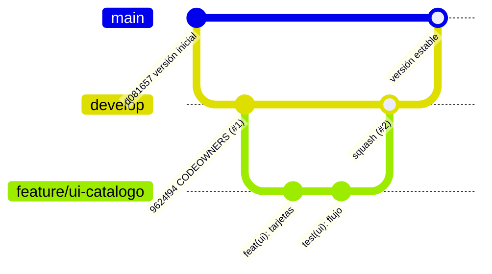

# Contribución: Git, GitHub y normas de desarrollo

Complementa a [CONTRIBUTING.md](../CONTRIBUTING.md), que define los roles del equipo y qué archivos puede modificar cada área. Aquí se detallan el flujo de Git con comandos de Windows, la resolución de conflictos, la revisión de Pull Requests y las normas de código.

## 1. Repositorio y equipo

| Dato | Valor |
|---|---|
| Repositorio | <https://github.com/vesseldot/Administrador-Prestamos-Libros> (público, licencia MIT) |
| Backend e integración | @vesseldot |
| Frontend (Tkinter) | @miasmee |
| Colaborador | @NoJumper1 (área por asignar) |
| Revisores automáticos | `.github/CODEOWNERS` (activo en `develop`) |

## 2. Ramas y protecciones vigentes

| Rama | Uso | Protección configurada en GitHub |
|---|---|---|
| `main` | Versión estable | `git push` directo permitido a quien tenga escritura; sin *force push* ni borrado. Pull Request recomendado, no obligatorio. |
| `develop` | Integración | Las mismas reglas que `main`. |
| `feature/<tema>` | Funcionalidades | Libre; se integra con un Pull Request hacia `develop` (recomendado) o con un `merge` y `git push`. |
| `fix/<tema>` | Correcciones | Libre; Pull Request hacia `develop`, o hacia `main` si es urgente. |
| `docs/<tema>`, `chore/<tema>` | Documentación y mantenimiento | Libre; Pull Request hacia `develop`. |

Las pruebas automáticas (`.github/workflows/pruebas.yml`) se ejecutan en cada `push` y en cada Pull Request hacia `main` o `develop`. Todavía **no son obligatorias** para integrar; se recomienda activarlas cuando el equipo se haya estabilizado.

## 3. Ciclo completo de una contribución



```powershell
# 1. Partir de develop actualizado
git switch develop
git pull origin develop

# 2. Crear la rama de trabajo
git switch -c feature/nombre-corto

# 3. Trabajar y probar
python -m pytest tests
python demo_interfaz.py            # si cambia la interfaz

# 4. Confirmar en commits pequeños
git status
git add ui/vistas/libros.py tests/test_interfaz.py
git commit -m "feat(ui): mostrar portada en la ficha del libro"

# 5. Subir la rama
git push -u origin feature/nombre-corto

# 6. Abrir el Pull Request hacia develop
gh pr create --base develop --fill   # o desde la web de GitHub
```

### Mensajes de commit

Formato *Conventional Commits*, en español: `<tipo>(<ámbito>): <resumen en imperativo>`.

| Tipo | Ejemplo |
|---|---|
| `feat` | `feat(prestamos): permitir renovar un préstamo` |
| `fix` | `fix(catalogo): aceptar ISBN con espacios` |
| `docs` | `docs: ampliar la guía de instalación` |
| `test` | `test(personas): cubrir la rectificación del correo` |
| `refactor` | `refactor(ui): extraer el componente de filtros` |
| `chore` | `chore: actualizar dependencias` |

## 4. Revisión de Pull Requests

**Quien revisa:**

```powershell
git fetch origin
git switch feature/nombre-corto
python -m pytest tests
python demo_interfaz.py          # revisar visualmente sin tocar datos reales
```

Lista de comprobación:

- `tests/test_arquitectura.py` pasa: la interfaz no accede a Redis, ChromaDB ni al modelo.
- No se incluyen `.env`, `secrets/`, llaves, `chroma_db/`, modelos, registros ni datos personales reales.
- Si cambia la API del servicio, se actualizó [INTEGRACION.md](../INTEGRACION.md) y `tests/test_api_interfaz.py`.
- Si cambia el esquema de Redis o la colección de Chroma, está documentada la migración.

Comenta en GitHub. Usa **Request changes** si hay que corregir algo y **Approve** cuando esté listo. GitHub no permite aprobar un Pull Request propio.

**Integración**: usa **Squash and merge** y borra la rama. Después, actualiza tu copia local:

```powershell
git switch develop
git pull origin develop
git branch -d feature/nombre-corto
```

## 5. Mantener la rama al día y resolver conflictos

```powershell
git fetch origin
git switch feature/nombre-corto
git merge origin/develop          # o: git rebase origin/develop
```

Si Git informa de conflictos:

1. `git status` muestra los archivos en conflicto.
2. Ábrelos y busca los marcadores `<<<<<<<`, `=======` y `>>>>>>>`. Conserva la combinación correcta de ambos cambios; VS Code ofrece *Accept Current*, *Accept Incoming* y *Accept Both*.
3. Ejecuta las pruebas (`python -m pytest tests`).
4. `git add <archivos>` y `git commit` (si usaste *merge*) o `git rebase --continue` (si usaste *rebase*).
5. `git push`. Después de un *rebase* de una rama ya subida, usa `git push --force-with-lease` **solo en tu rama**, nunca en `main` ni en `develop`.

Para abandonar un *merge* o un *rebase* fallido: `git merge --abort` o `git rebase --abort`.

**Conflictos frecuentes y quién decide:**

- En `ui/` resuelve el frontend.
- En `servicios.py` y `db_*.py` resuelve el backend.
- En `INTEGRACION.md` y `ui/app.py` se coordinan ambos.

## 6. Normas de desarrollo

### Estilo
- PEP 8 con líneas de **120 caracteres como máximo**; el proyecto no tiene ninguna línea más larga.
- Nombres descriptivos en español, igual que el resto del código. Clases en `CamelCase`; funciones y variables en `snake_case`; constantes en `MAYÚSCULAS`.
- Importaciones agrupadas en el orden biblioteca estándar, terceros y módulos del proyecto, y ordenadas alfabéticamente.

### Comentarios y docstrings
- **No** se escriben comentarios que repitan lo que el código ya dice.
- Hay docstrings en módulos, clases y funciones públicas o complejas: qué hacen, qué devuelven y qué excepciones lanzan.
- Las únicas marcas de comentario permitidas en línea son las directivas de herramientas, como `# noqa: BLE001` o `# noqa: E402`.

### Excepciones
- Los errores que el usuario puede corregir se lanzan como `ValueError` con un mensaje en español listo para mostrar.
- Los errores del sistema se dejan propagar hasta la interfaz, que los presenta con `describir_error`. No se capturan excepciones de forma genérica salvo en los límites (tareas, arranque) y siempre registrándolas en `biblioteca.log`, marcadas con `# noqa: BLE001`.
- **Nunca** se escriben datos personales en el registro ni en mensajes de error.

### Validaciones
- Todas las reglas de datos viven en `validaciones.py` (`validar_libro`, `validar_persona`) y se aplican en el backend.
- La interfaz puede validar antes para dar mejor respuesta al usuario, pero no puede ser la única validación.

### Pruebas
- Toda funcionalidad nueva del backend lleva su prueba en `tests/`, con fakeredis y una Chroma temporal (fixtures de `tests/conftest.py`).
- Los cambios en la API para la interfaz se prueban en `tests/test_api_interfaz.py`.
- Antes de cada commit: `python -m pytest tests`.

### Seguridad y separación de responsabilidades
- La interfaz solo usa la API pública de `ServicioBiblioteca` ([INTEGRACION.md](../INTEGRACION.md)).
- Los secretos solo van en `.env` o en `secrets/`, nunca en el código.
- No se cambian las estructuras de Redis, las colecciones de Chroma, el modelo ni su dimensión sin documentar la migración ([ARQUITECTURA.md](ARQUITECTURA.md)).

## 7. Si se sube un secreto por error

1. **Avisa de inmediato** al responsable del repositorio.
2. Cambia el secreto: genera una llave nueva (`python gestionar_secretos.py nueva-llave`) o cambia la contraseña.
3. Limpiar el historial (`git filter-repo`) es una operación destructiva que reescribe las ramas: requiere coordinar a todo el equipo y la autorización del responsable.
