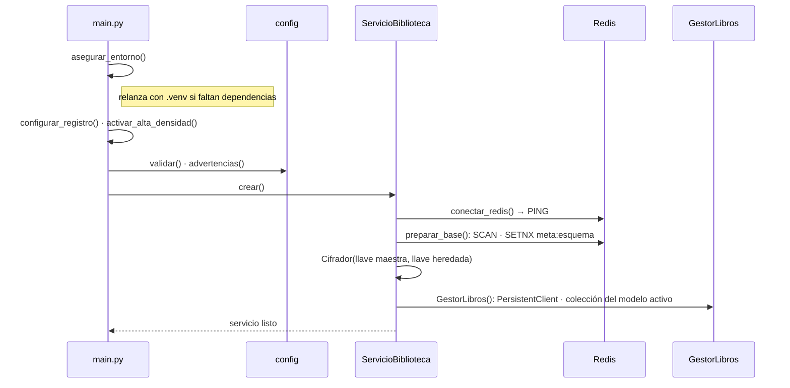
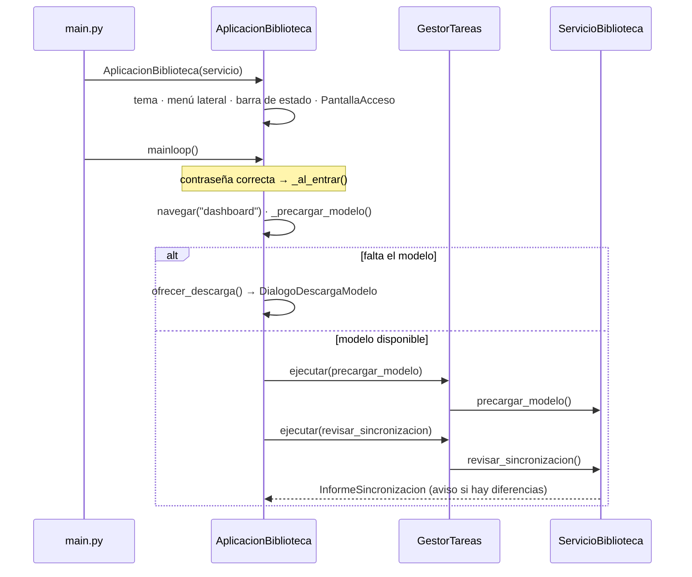
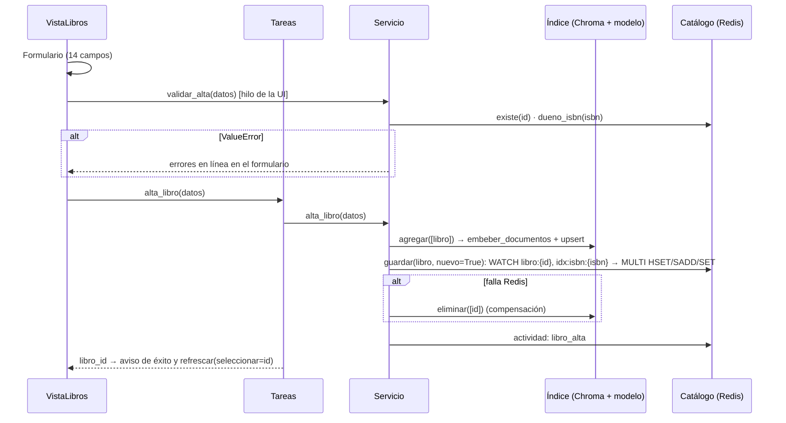
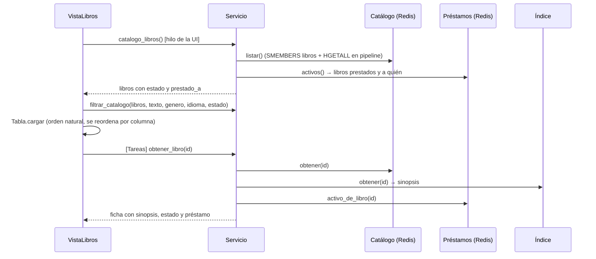
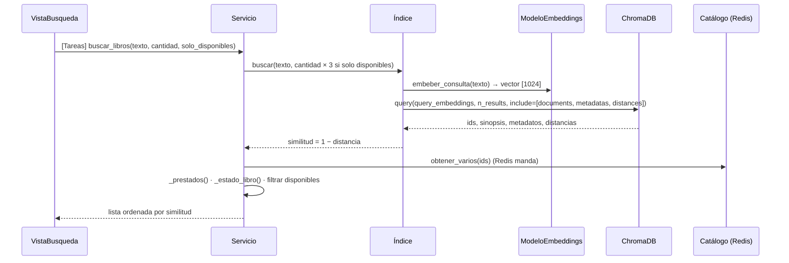
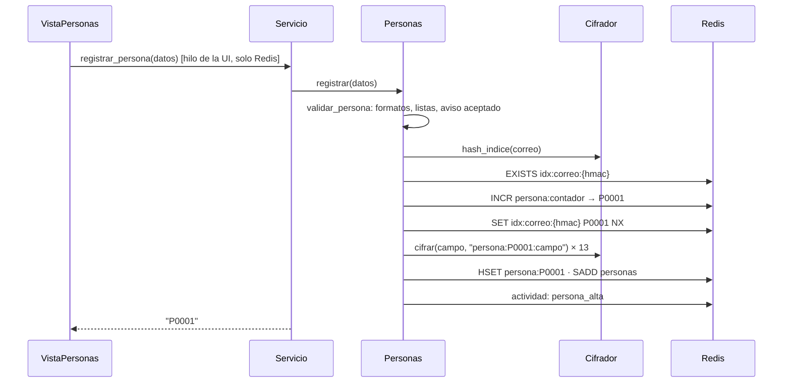
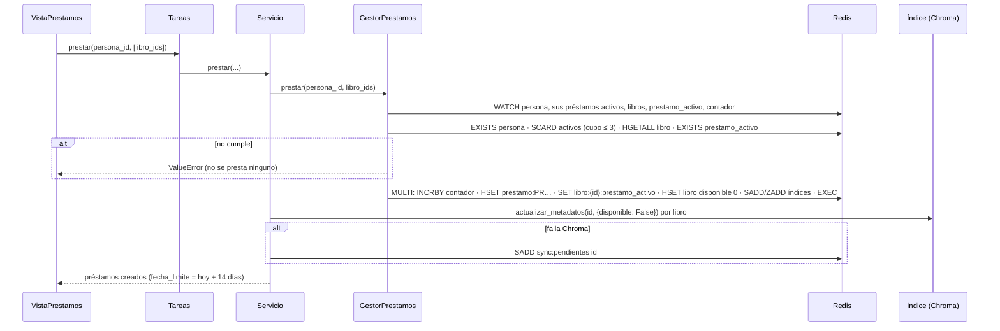

# Flujos de datos

Recorrido de cada operación desde la interfaz hasta Redis, ChromaDB y el modelo. Los nombres de clases, métodos y llaves corresponden al código actual; en las llaves de Redis se omite el prefijo `bib:`.

**Convenciones de los diagramas**: *Vista* es la sección de `ui/vistas/`; *Tareas* es `ui/tareas.GestorTareas` (hilo trabajador); *Servicio* es `servicios.ServicioBiblioteca`; *Catálogo*, *Personas* y *Préstamos* son los gestores de Redis (`db_catalogo`, `db_personas`, `db_prestamos`); *Índice* es `db_libros.GestorLibros` (ChromaDB + modelo).

## 1. Arranque de la aplicación

Después, la ventana y el acceso:

Errores que detienen el arranque y muestran un diálogo (`main.error_de_arranque`): configuración inválida, Redis sin conexión o con credenciales incorrectas, base ocupada por llaves ajenas (`ErrorBaseOcupada`) y llave de cifrado inválida (`ErrorLlave`).

## 2. Alta de un libro

Escrituras en Redis: `HSET libro:{id}`, `SADD libros {id}`, `SET idx:isbn:{isbn} {id}`. En ChromaDB: `upsert(ids, documents=[sinopsis], metadatas, embeddings)`.

## 3. Importación por lote (CSV o JSON)

1. `VistaLibros.importar` abre un diálogo para elegir el archivo, que parte de `datos/`.
2. `[Tareas] servicio.importar_archivo(ruta, progreso)`: `leer_archivo_libros` detecta si el CSV usa `,` o `;` y admite JSON como lista o como `{"libros": [...]}`.
3. `importar_lote` valida **cada fila** con `validar_libro` y rechaza los ids o ISBN repetidos dentro del archivo o ya existentes en la base.
4. Las filas válidas se indexan en Chroma en lotes de 32, informando el progreso, y después se escriben en Redis con `CatalogoRedis.guardar_lote`, una única transacción `MULTI`.
5. Si Redis falla, se borran de Chroma los ids recién insertados.
6. La vista muestra un `Dialogo` con el total, los importados y los rechazados, cada uno con su fila, id y motivos.

## 4. Catálogo, filtros y ficha

## 5. Búsqueda semántica

«Buscar similares», desde la ficha del catálogo, reutiliza este flujo con la sinopsis del libro como consulta y lo excluye de los resultados.

## 6. Actualización de un libro

1. `VistaLibros.editar` → `[Tareas] obtener_libro(id)` → el formulario se abre con los datos. El `id` queda bloqueado, y `disponible` también si el libro está prestado.
2. `[Tareas] actualizar_libro(id, datos)`:
   - Si el libro tiene un préstamo activo, fuerza `disponible=False`.
   - Valida los datos y comprueba que el ISBN no pertenezca a otro libro.
   - Guarda una **copia previa** en Chroma con `obtener(id, con_embedding=True)`.
   - Ejecuta `GestorLibros.actualizar(libro, recalcular_embedding=sinopsis_cambió)`. Si la sinopsis no cambió, solo actualiza los metadatos.
   - Ejecuta `CatalogoRedis.guardar(libro, nuevo=False)`, que actualiza el HASH y, si cambió el ISBN, mueve el índice `idx:isbn`.
   - Si falla Redis, `GestorLibros.restaurar(copia)`.

## 7. Eliminación de un libro

1. `VistaLibros.eliminar`: si el libro está prestado, informa y no continúa; si no, pide confirmación.
2. `[Tareas] eliminar_libro(id)`: comprueba que no tenga un préstamo activo, toma una copia previa con su embedding, borra el documento de Chroma y después el registro de Redis (`DEL libro:{id}`, `SREM libros`, `DEL idx:isbn`). Si Redis falla, reinserta la copia en Chroma.
3. **El historial de préstamos se conserva**, porque cada préstamo guarda una copia del título y del autor.

## 8. Alta y actualización de personas

**Actualización** (`actualizar_persona`, que rectifica los datos):

- Valida los datos de nuevo.
- Si cambió el correo, reserva el nuevo índice con `SET NX` y borra el anterior.
- Vuelve a cifrar los 13 campos.
- Conserva la fecha del aviso original (`HSETNX fecha_aviso`) y actualiza `fecha_actualizacion`.

**Catálogo de personas** (`buscar_personas`):

- Lee todas las personas con un *pipeline* (`HGETALL` + `SCARD` de los préstamos activos de cada una).
- Las descifra y filtra en memoria por id, nombre completo, tipo, ocupación, ciudad y estado.
- La vista **enmascara** el correo y el teléfono antes de mostrarlos.

## 9. Préstamo de libros

`fecha_limite` se calcula con `BIBLIOTECA_DIAS_PRESTAMO` (14 por defecto). Un préstamo se considera **vencido** cuando sigue activo y `fecha_limite` es anterior a la fecha de hoy; ese estado se calcula al leer, no se guarda.

## 10. Devolución

1. `VistaPrestamos.devolver` usa los préstamos seleccionados; `devolver_todos` pide confirmación y envía `None`, que significa todos.
2. `[Tareas] servicio.devolver(persona_id, prestamo_ids)` → `GestorPrestamos.devolver`: `WATCH` sobre el conjunto de préstamos activos y cada préstamo. Comprueba que todos sigan activos y pertenezcan a la persona, y en `MULTI`:
   - `HSET prestamo:{id} estado=devuelto, fecha_devolucion=<ahora>`
   - `DEL libro:{id}:prestamo_activo`
   - `HSET libro:{id} disponible 1`, si el libro aún existe
   - `SREM` de los conjuntos de préstamos activos; `SREM personas_con_prestamo` si ya no le quedan préstamos
3. Copia de la disponibilidad a Chroma, con anotación en `sync:pendientes` si falla.
4. **El historial no se borra**: `persona:{id}:historial` y `prestamos:todos` conservan cada préstamo.

## 11. Personas con préstamos

1. `VistaPersonasConPrestamo.refrescar` → `[Tareas] personas_con_prestamos()`: agrupa `prestamos.activos()` por persona y descifra solo a esas personas (`personas.listar(ids=…)`).
2. La vista arma un árbol de personas y sus préstamos con el correo y el teléfono **enmascarados**. «Mostrar contacto» los revela solo para la persona seleccionada durante 20 segundos.

## 12. Cambio de modelo y sincronización

- **Cambio de modelo** (`cambiar_modelo`): toma las sinopsis del índice actual y los metadatos de Redis, abre o crea la colección del nuevo modelo y la sincroniza (`_sincronizar_coleccion`): la colección conserva lo que ya procesó: compara por sinopsis y solo calcula los vectores de los libros nuevos o con la sinopsis editada, reutiliza el resto y elimina los que ya no existen. Si la colección se calculó con otra revisión del modelo, recalcula todo una vez. Solo entonces cambia el modelo activo, guarda `modelo_activo.txt` y deja en `resumen_ultimo_cambio` cuántos libros reutilizó, calculó y eliminó. Si algo falla, el modelo anterior sigue activo y lo avanzado queda guardado para el siguiente intento.
- **Revisar sincronización**: compara los ids de Redis con los de Chroma, los metadatos (con tolerancia en los números con decimales) y `sync:pendientes`.
- **Reparar**: copia a Chroma los metadatos de Redis de los libros desfasados o pendientes.
- **Importar huérfanos**: valida y da de alta en Redis los documentos que solo existen en Chroma.

## 13. Portadas

Las portadas no pasan por Redis ni por ChromaDB: son archivos en `BIBLIOTECA_DIR_PORTADAS`.

1. **Ficha** (`VistaLibros._cargar_detalle`): en una tarea se piden `obtener_libro(id)`, que incluye `portada` con el origen, y `portada_libro(id, ancho, alto)`, que devuelve un PNG ajustado al marco. La interfaz lo muestra con `tk.PhotoImage` (componente `Portada`), sin Pillow.
2. **Elegir imagen…** (`asignar_portada`): comprueba que el libro existe en Redis, lee el archivo (máximo 15 MB), lo valida y lo convierte a JPEG de 600×900 como máximo (`normalizar_imagen`) y lo guarda de forma atómica como `{id}.jpg`, con `{id}.json` (origen y fecha). Registra el evento en la bitácora.
3. **Buscar en internet** (`buscar_portada`, en un hilo independiente): `ClienteOpenLibrary.buscar` consulta `/isbn/{isbn}.json` y acepta la edición solo si su título coincide con el del libro; si no, busca en `/search.json` por título y autor. Descarga la imagen de `covers.openlibrary.org`. Entre peticiones hay una pausa de 1 s y cada petición se reintenta una vez si falla la red.
4. **Alta de un libro**: al terminar, la vista lanza `buscar_portada` en segundo plano; si la encuentra, la ficha se actualiza sola.
5. **Descarga en lote** (Configuración › Sistema, `descargar_portadas`): recorre solo los libros sin portada, informa el progreso por libro y se detiene con `detener_descarga_portadas()`. Tras 3 fallos de red seguidos se interrumpe con `ErrorPortada`.
6. **Eliminación de un libro**: después de borrarlo de Redis y de Chroma, `eliminar_libro` borra también su portada.
