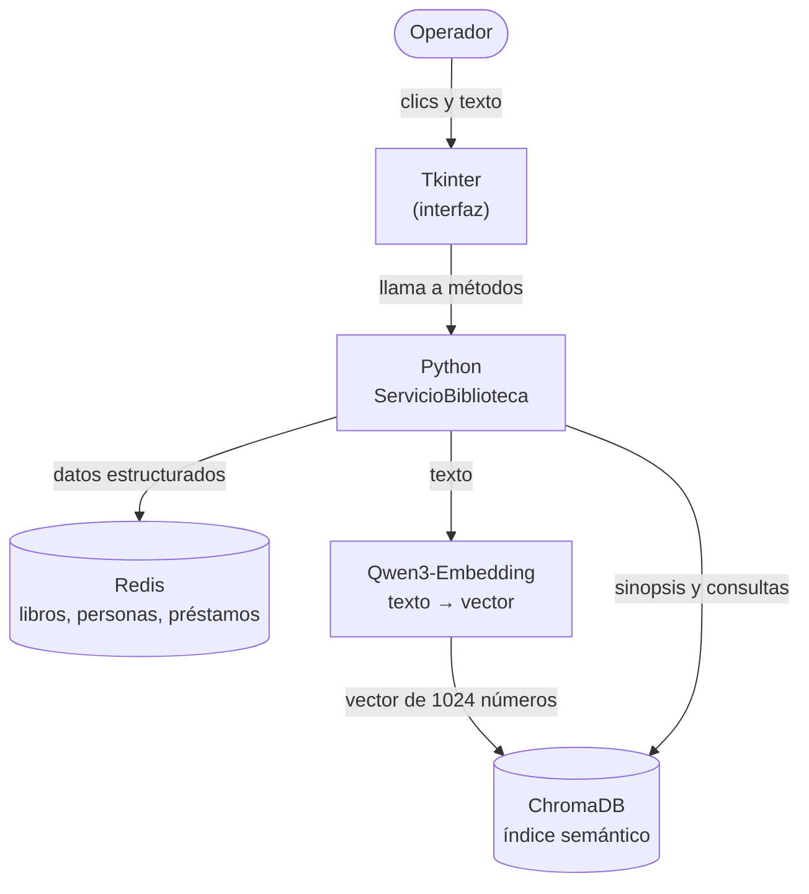
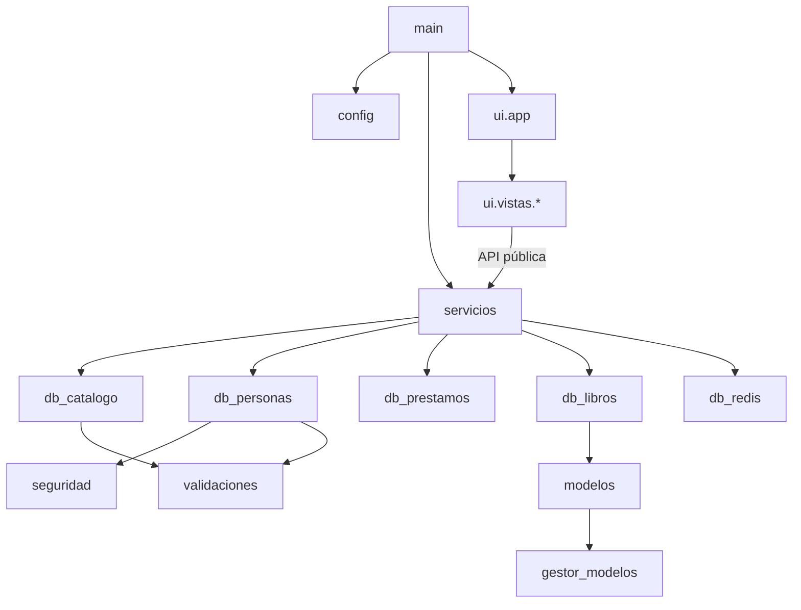
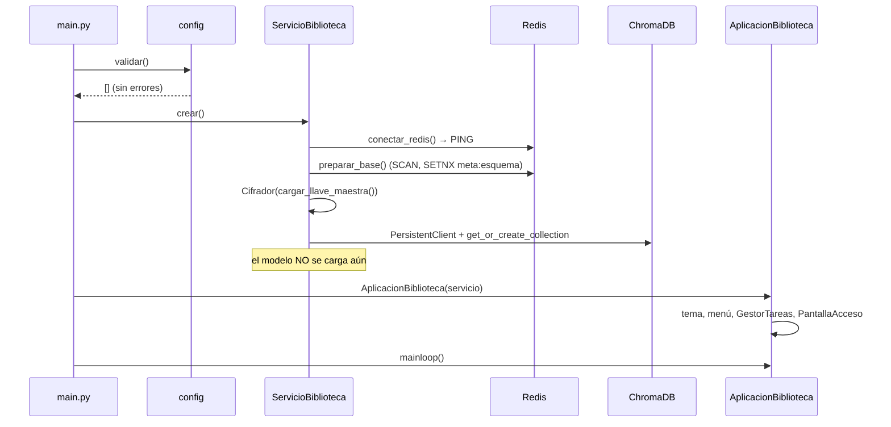
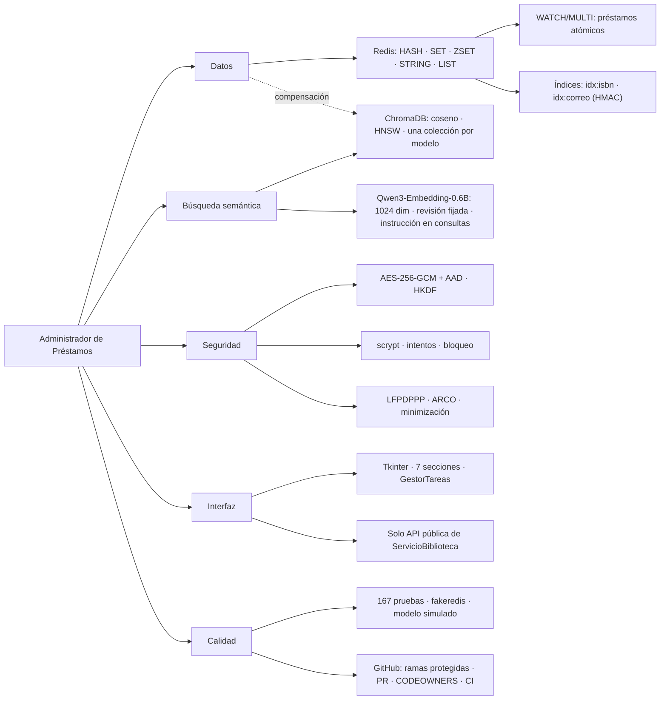

# Guía de estudio del proyecto

**Administrador de Préstamos de Libros**: cómo funciona por dentro y cómo defenderlo

Esta guía sirve para **entender y explicar** el proyecto en una exposición o defensa académica. Avanza desde la visión general hasta el detalle del código, con fragmentos copiados del repositorio, preguntas de defensa y ejercicios resueltos. Para la referencia técnica completa, consulta la [Guía técnica para colaboradores](GUIA_TECNICA_COLABORADORES.md).

> **Cómo usar esta guía.** Lee los capítulos 1 a 4 para tener el panorama. Estudia los capítulos 5 a 9 con el código abierto al lado. Practica con los capítulos 11 y 12. Usa el capítulo 13 para repasar el día anterior a la defensa.

---

## 1. Visión global

### 1.1 El proyecto en una frase

Una aplicación de escritorio que administra el **catálogo**, las **personas** y los **préstamos** de una biblioteca, y que permite **buscar libros por el significado** de lo que el usuario describe.

### 1.2 Qué problema resuelve

| Problema | Solución en el proyecto |
|---|---|
| Saber qué libros hay y cuáles están prestados | Catálogo en Redis con el estado calculado a partir de los préstamos activos. |
| Controlar quién tiene cada libro y desde cuándo | Préstamos con fecha límite, límite de 3 libros por persona e historial. |
| Encontrar un libro sin saber el título | Búsqueda semántica: la sinopsis se convierte en un vector y se compara con la consulta. |
| Proteger los datos personales | Cifrado AES-256-GCM por campo, enmascaramiento y derechos ARCO. |

### 1.3 Cómo se relacionan las tecnologías



- **Python** es el lenguaje de todo el sistema.
- **Tkinter** dibuja las ventanas y recibe las acciones del operador.
- **Redis** guarda los datos con estructura: los libros, las personas, los préstamos y la bitácora. Es la **fuente de verdad**.
- **ChromaDB** guarda las sinopsis junto con su vector y responde «¿qué vectores se parecen a este?».
- **Qwen3-Embedding-0.6B** convierte el texto en vectores.

### 1.4 Flujo general de datos

1. El operador escribe o pulsa algo en una **vista** de Tkinter.
2. La vista llama a un método del **servicio** (`ServicioBiblioteca`).
3. El servicio **valida** los datos y aplica las reglas de negocio.
4. El servicio escribe o lee en **Redis** y, si hay sinopsis de por medio, en **ChromaDB** usando el **modelo**.
5. El resultado vuelve a la vista, que lo muestra.

### 1.5 Cómo explicar el proyecto en 3 minutos

> «Hicimos un administrador de préstamos de libros en Python con interfaz Tkinter. Usamos **dos bases NoSQL** con papeles distintos. **Redis**, una base clave-valor, guarda los libros, las personas y los préstamos con estructuras como HASH, SET y ZSET, y usa transacciones optimistas con WATCH para que dos préstamos simultáneos no presten el mismo libro. **ChromaDB**, una base vectorial, guarda las sinopsis convertidas en vectores de 1024 dimensiones por el modelo **Qwen3-Embedding-0.6B**, que se ejecuta en local. Así podemos buscar «un niño mago que va a una escuela» y encontrar *Harry Potter* aunque no compartan palabras.
>
> Como no hay una transacción que abarque las dos bases, usamos **compensación**: si Redis falla después de escribir en Chroma, deshacemos lo de Chroma. Los datos personales se cifran campo por campo con **AES-256-GCM**, siguiendo los principios de la LFPDPPP. El código está dividido en capas: la interfaz solo habla con el servicio, y una prueba automática lo verifica. Tenemos 167 pruebas automatizadas y el repositorio está en GitHub con ramas protegidas.»

---

## 2. Fundamentos tecnológicos

### 2.1 Python

- **Qué es**: un lenguaje de propósito general, interpretado, con una biblioteca muy amplia para ciencia de datos e IA.
- **Por qué aquí**: sentence-transformers, ChromaDB y el cliente de Redis tienen bibliotecas oficiales en Python, y Tkinter viene incluido.
- **Dónde está**: en todo el proyecto (49 archivos `.py`).
- **Ventajas**: el desarrollo es rápido y hay bibliotecas maduras. **Desventajas**: el GIL limita el paralelismo con hilos y es más lento que un lenguaje compilado; aquí no importa, porque el trabajo pesado lo hacen PyTorch y Chroma en código nativo.
- **Alternativas**: Java con JavaFX, o C# con WPF.

### 2.2 Tkinter

- **Qué es**: la biblioteca gráfica estándar de Python, basada en Tcl/Tk. `ttk` añade widgets con temas.
- **Por qué**: no requiere instalación, funciona en Windows, Linux y macOS, y es suficiente para una aplicación de escritorio de gestión.
- **Dónde**: en `ui/`. El tema propio está en `ui/tema.py` y los iconos en `ui/iconos.py`.
- **Limitación clave**: **Tkinter no es seguro entre hilos**. Solo el hilo principal puede tocar los widgets. Por eso existe `GestorTareas` (sección 4.4).
- **Alternativas**: PyQt o PySide (más potentes, con licencias más complejas) y una interfaz web (Flask + HTML).

### 2.3 Redis

- **Qué es**: una base de datos **clave-valor en memoria** con estructuras de datos (STRING, HASH, LIST, SET, ZSET), persistencia opcional en disco y operaciones atómicas.
- **Por qué**: las operaciones son muy rápidas, la estructura de cada entidad encaja con un HASH y las transacciones optimistas resuelven los préstamos simultáneos.
- **Dónde**: `db_redis.py`, `db_catalogo.py`, `db_personas.py`, `db_prestamos.py`.
- **Ventajas**: velocidad, estructuras ricas y atomicidad. **Desventajas**: no tiene consultas tipo SQL ni JOIN, así que los índices secundarios se construyen a mano (`idx:isbn`, `idx:correo`), y los datos deben caber en memoria.
- **Alternativas**: MongoDB (documentos y consultas más ricas) o PostgreSQL (relacional, con transacciones ACID).

### 2.4 ChromaDB

- **Qué es**: una **base de datos vectorial** embebida. Guarda documentos con su vector y metadatos, y encuentra los vectores más cercanos a uno dado con un índice HNSW.
- **Por qué**: se instala con `pip`, no necesita servidor, persiste en una carpeta y su API es sencilla.
- **Dónde**: `db_libros.py`.
- **Ventajas**: simplicidad y búsqueda aproximada rápida. **Desventajas**: no tiene transacciones, y su escala es menor que la de los servicios dedicados.
- **Alternativas**: FAISS (solo índice, sin persistencia de documentos), Qdrant, Milvus, pgvector o Redis Stack con búsqueda vectorial.

### 2.5 Embeddings y modelo semántico

- Un **embedding** es una lista de números (un **vector**) que representa el significado de un texto. Los textos con significado parecido producen vectores cercanos.
- **Qwen3-Embedding-0.6B** es una red neuronal Transformer de 600 millones de parámetros que produce vectores de **1024 dimensiones**. Es multilingüe.
- La **similitud del coseno** mide el ángulo entre dos vectores: 1 si apuntan igual y 0 si son perpendiculares. Chroma devuelve una **distancia** (`1 − coseno`), y el proyecto la convierte en similitud con `1 - dist`.
- **Búsqueda semántica**: se busca por significado, no por palabras exactas. **Búsqueda tradicional**: se buscan coincidencias de texto. El filtro del catálogo (`filtrar_catalogo`) es tradicional; «Buscar libros» es semántica.

### 2.6 Sentence-Transformers, Transformers, PyTorch y Hugging Face

| Pieza | Papel |
|---|---|
| **PyTorch** | Motor de cálculo con tensores, en CPU o GPU (CUDA). |
| **Transformers** | Implementación de la arquitectura del modelo (Qwen3). |
| **Sentence-Transformers** | Capa que convierte «texto → vector» en una sola llamada (`encode`), con *pooling* y normalización. |
| **Hugging Face Hub** | Repositorio público de donde se descarga el modelo (`huggingface_hub.snapshot_download`). |

### 2.7 Cifrado y otros conceptos de seguridad

- **AES-256-GCM**: cifrado simétrico con llave de 256 bits. El modo GCM añade una **etiqueta de autenticación**: si alguien altera el dato cifrado, el descifrado falla.
- **HKDF**: deriva varias llaves independientes a partir de una llave maestra.
- **HMAC**: una huella con llave. Permite comprobar si un correo ya existe sin guardarlo en claro (el **índice ciego**).
- **scrypt**: hash de contraseñas deliberadamente lento y costoso en memoria, para dificultar los ataques por fuerza bruta.

### 2.8 Datos personales y LFPDPPP

La **Ley Federal de Protección de Datos Personales en Posesión de los Particulares** (México) exige un aviso de privacidad, consentimiento, medidas de seguridad y atención a los derechos **ARCO** (Acceso, Rectificación, Cancelación y Oposición). El proyecto implementa medidas técnicas alineadas con esos principios, pero **no constituye una certificación de cumplimiento legal** ([SEGURIDAD.md](SEGURIDAD.md)).

### 2.9 Git y GitHub

**Git** es el control de versiones: guarda el historial de cambios y permite trabajar en ramas. **GitHub** aloja el repositorio y añade Pull Requests, revisiones, protección de ramas, CODEOWNERS y la integración continua (GitHub Actions).

---

## 3. Anatomía del código

### 3.1 Mapa de módulos



### 3.2 `main.py`: el punto de entrada

```python
def main():
    registro = configurar_registro()
    activar_alta_densidad()
    errores = config.validar()
    if errores:
        registro.error("Configuración inválida: %d problema(s)", len(errores))
        return error_de_arranque("Configuración inválida",
                                 "Corrige estos valores en el archivo .env (ver .env.example):\n\n• "
                                 + "\n• ".join(errores))
    ...
    try:
        servicio = ServicioBiblioteca.crear()
    except redis.AuthenticationError:
        return error_de_arranque("Redis rechazó la conexión", ...)
    except (redis.ConnectionError, redis.TimeoutError) as error:
        ...
    except ErrorBaseOcupada as error:
        return error_de_arranque("Base de Redis ocupada", str(error))
```

**Qué hace.** Prepara el registro técnico, valida la configuración y crea el servicio. Cada fallo posible del arranque tiene su propio mensaje para el usuario.

**Por qué así.** Un error al arrancar es la causa más común de que «no funcione». Con un diálogo específico para cada caso (Redis apagado, contraseña incorrecta o base ocupada), el usuario sabe exactamente qué corregir.

**Importaciones tardías.** `redis`, `servicios` y la interfaz se importan **después** de validar. Así, si falta una dependencia, `asegurar_entorno()` puede relanzar el programa con el Python del entorno virtual antes de que falle una importación.

### 3.3 `config.py`: configuración validada

```python
def validar() -> list[str]:
    """Regresa la lista de problemas de configuración (vacía si todo está bien)."""
    errores = list(_ERRORES)
    if not REDIS_PREFIJO.endswith(":") or len(REDIS_PREFIJO) < 2:
        errores.append(f"REDIS_PREFIJO='{REDIS_PREFIJO}' debe terminar en ':' (ej. bib:).")
    if DISPOSITIVO not in ("auto", "cuda", "cpu"):
        errores.append(f"BIBLIOTECA_DISPOSITIVO='{DISPOSITIVO}' debe ser auto, cuda o cpu.")
    ...
```

**Concepto.** La función devuelve **todos** los errores a la vez en lugar de detenerse en el primero, para que el usuario los corrija en una sola pasada. `_ERRORES` acumula los fallos detectados al leer las variables, por ejemplo un `REDIS_PORT` no numérico.

### 3.4 `db_redis.py`: llaves con prefijo

```python
class Llaves:
    """Construye todas las llaves de Redis bajo un prefijo común."""

    def __init__(self, prefijo: str = config.REDIS_PREFIJO):
        self.prefijo = prefijo

    def _k(self, *partes) -> str:
        return self.prefijo + ":".join(str(p) for p in partes)

    def libro(self, libro_id):
        return self._k("libro", libro_id)

    def idx_isbn(self, isbn):
        return self._k("idx", "isbn", isbn)
```

**Concepto.** Todas las llaves se construyen en **un solo lugar**. `Llaves().libro("libro09")` devuelve `"bib:libro:libro09"`. Esto evita errores tipográficos y permite cambiar el prefijo; las pruebas de integración usan `prueba_integracion:`.

```python
def preparar_base(r: redis.Redis, llaves: Llaves):
    """Verifica que la base esté vacía o solo contenga llaves propias y marca el esquema."""
    ajenas = any(not llave.startswith(llaves.prefijo) for llave in r.scan_iter(count=1000))
    if ajenas:
        ...
        raise ErrorBaseOcupada(...)
    r.setnx(llaves.esquema, VERSION_ESQUEMA)
```

**Concepto.** Es una **salvaguarda**: si la base elegida tiene datos de otro proyecto, la aplicación se niega a arrancar. Usa `SCAN` (iterativo, no bloquea el servidor) en lugar de `KEYS`.

### 3.5 `servicios.py`: el corazón

`ServicioBiblioteca` es la **única puerta** entre la interfaz y los datos. Agrupa:

- Los gestores (`catalogo`, `indice`, `personas`, `prestamos`, `actividad`, `acceso`).
- Las reglas que cruzan entidades (no eliminar un libro prestado, estado calculado y estadísticas).
- La **coordinación entre Redis y Chroma** con compensación (capítulo 9).
- Los métodos de la API pública que usa la interfaz ([INTEGRACION.md](../INTEGRACION.md)).

Se crea con `ServicioBiblioteca.crear()`, que conecta todas las piezas reales. Las pruebas y la demostración construyen el servicio con piezas falsas (fakeredis, Chroma en memoria, modelo simulado). Esto es **inyección de dependencias**.

### 3.6 Interfaz: `ui/app.py` y `ui/vistas/`

- `AplicacionBiblioteca` es la ventana. Tiene un menú lateral con las 7 secciones de `SECCIONES` y crea cada vista la primera vez que se visita.
- Cada vista hereda de `Vista` y define `construir()` (los widgets) y `refrescar()` (pedir los datos).
- Las vistas **nunca** importan `redis`, `chromadb` ni los módulos `db_*`. `tests/test_arquitectura.py` lo comprueba analizando las importaciones de cada archivo de `ui/`.

### 3.7 Validaciones

```python
def isbn_valido(isbn: str) -> bool:
    """Comprueba longitud y dígito de control de un ISBN-10 o ISBN-13."""
    digitos = normalizar_isbn(isbn)
    if len(digitos) == 13 and digitos.isdigit():
        suma = sum(int(c) * (1 if i % 2 == 0 else 3) for i, c in enumerate(digitos))
        return suma % 10 == 0
    if len(digitos) == 10 and digitos[:9].isdigit() and (digitos[9].isdigit() or digitos[9] == "X"):
        suma = sum((10 - i) * (10 if c == "X" else int(c)) for i, c in enumerate(digitos))
        return suma % 11 == 0
    return False
```

**Concepto.** En un ISBN-13, los dígitos se multiplican alternadamente por 1 y por 3, y la suma debe ser múltiplo de 10. En un ISBN-10, los pesos van de 10 a 1, la suma debe ser múltiplo de 11 y una «X» vale 10. Así se detectan errores de captura, como un dígito cambiado.

### 3.8 Manejo de errores

- **Errores del usuario** (`ValueError`): el mensaje en español se muestra tal cual. Por ejemplo, «El ISBN … ya pertenece al libro 'libro03'».
- **Errores del sistema** (Redis caído, modelo ausente, datos ilegibles): se propagan hasta la interfaz, y `describir_error(error)` los traduce a un título, un mensaje y una sugerencia.
- **Excepciones inesperadas** dentro de tareas: `GestorTareas` las registra en `biblioteca.log` con la traza y las entrega a `manejar_error`.

---

## 4. Ejecución paso a paso

### 4.1 Del doble clic a la ventana



### 4.2 Conexión a Redis

```python
def conectar_redis(host=None, port=None, db=None, password=None) -> redis.Redis:
    cliente = redis.Redis(
        host=host or config.REDIS_HOST, port=port or config.REDIS_PORT,
        db=config.REDIS_DB if db is None else db,
        password=password if password is not None else config.REDIS_PASSWORD,
        username=config.REDIS_USUARIO, ssl=config.REDIS_SSL,
        decode_responses=True, socket_connect_timeout=config.REDIS_TIMEOUT_SEGUNDOS,
        socket_timeout=config.REDIS_TIMEOUT_SEGUNDOS * 3, health_check_interval=30)
    cliente.ping()
    return cliente
```

- `decode_responses=True` hace que Redis devuelva `str` en lugar de `bytes`.
- Los *timeouts* evitan que la aplicación se quede colgada si Redis no responde.
- `ping()` fuerza la conexión **ahora**, para que el error salga en el arranque y no en la primera operación.

### 4.3 Apertura de ChromaDB

```python
def _abrir_coleccion(self, clave: str):
    return self.cliente.get_or_create_collection(
        name=nombre_coleccion(clave),
        configuration={"hnsw": {"space": "cosine"}},
        metadata={"modelo": MODELOS[clave]["nombre_completo"], "dimensiones": MODELOS[clave]["dim"]},
        embedding_function=None)
```

- `space: cosine` indica a Chroma que mida distancias por coseno.
- `embedding_function=None` significa que **la aplicación** calcula los vectores con su propio modelo; Chroma no descarga ningún modelo.
- El nombre de la colección depende del modelo, de modo que cambiar de modelo nunca mezcla vectores de dimensiones distintas.

### 4.4 Carga perezosa del modelo y uso de hilos

```python
@property
def modelo(self):
    with self._candado:
        if self._modelo is None:
            self._modelo = self._cargar()
        return self._modelo
```

El modelo se carga **la primera vez que se necesita** (patrón *lazy loading*), protegido con un candado (`threading.Lock`) para que no se cargue dos veces. La interfaz lo precarga en segundo plano justo después del acceso, para que la primera búsqueda sea rápida.

```python
def envoltura():
    try:
        self._cola.put(("fin", al_terminar, trabajo(), None, al_error))
    except Exception as error:  # noqa: BLE001
        log.exception("Error en tarea en segundo plano (%s)", type(error).__name__)
        self._cola.put(("fin", al_terminar, None, error, al_error))
```

`GestorTareas.ejecutar` envía `trabajo()` a un **único hilo trabajador**. El resultado se deposita en una cola, y el hilo de Tkinter la revisa cada 40 ms con `after` (`_revisar`) y ejecuta `al_terminar(resultado)`. Así la ventana nunca se congela y Tkinter solo se toca desde su hilo.

### 4.5 Registro de un libro, de principio a fin

1. El operador pulsa **Agregar libro** y llena el `Formulario`.
2. Al guardar, la vista llama a `servicio.validar_alta(datos)` (en el hilo de Tkinter, porque solo usa Redis): `validar_libro` y la unicidad del id y del ISBN.
3. Si es válido, la vista ejecuta en el trabajador `servicio.alta_libro(datos)`.
4. `alta_libro` calcula el embedding de la sinopsis y hace `upsert` en Chroma; luego escribe en Redis con `CatalogoRedis.guardar` (transacción WATCH).
5. Se registra el evento en la bitácora, se muestra un aviso de éxito y la tabla se refresca.

### 4.6 Búsqueda semántica, de principio a fin

1. El operador escribe «un detective que resuelve crímenes en Londres» y pulsa **Buscar**.
2. `servicio.buscar_libros(texto, 10, solo_disponibles)` se ejecuta en el trabajador.
3. `GestorLibros.buscar` convierte la consulta en un vector **con la instrucción de consulta** y pide a Chroma los vecinos más cercanos.
4. El servicio completa cada resultado con los datos de Redis y el estado (disponible o prestado).
5. La vista muestra tarjetas con el título, el autor, el estado y el porcentaje de similitud.

---

## 5. Redis a fondo

### 5.1 Llaves y estructuras

| Llave (con prefijo `bib:`) | Tipo | Contenido | Comandos usados |
|---|---|---|---|
| `libro:{id}` | HASH | isbn, titulo, autor, anio, editorial, genero, tema, idioma, pasta, paginas, calificacion, disponible, fechas | `HSET`, `HGETALL`, `HGET` |
| `libros` | SET | Ids de todos los libros | `SADD`, `SREM`, `SMEMBERS`, `SCARD` |
| `idx:isbn:{isbn}` | STRING | Id del libro con ese ISBN | `GET`, `SET`, `DEL` |
| `persona:{id}` | HASH | 13 campos cifrados + `tipo_usuario` + `correo_hash` + fechas | `HSET`, `HGETALL`, `HSETNX` |
| `personas` | SET | Ids de personas | `SADD`, `SMEMBERS`, `SCARD` |
| `persona:contador` | STRING | Último número de persona | `INCR` |
| `idx:correo:{hmac}` | STRING | Id de la persona con ese correo | `SET NX`, `EXISTS` |
| `prestamo:{id}` | HASH | persona_id, libro_id, titulo, autor, fechas y estado | `HSET`, `HGETALL` |
| `prestamo:contador` | STRING | Último número de préstamo | `INCRBY` |
| `libro:{id}:prestamo_activo` | STRING | Préstamo activo de ese libro | `SET`, `EXISTS`, `DEL` |
| `persona:{id}:prestamos_activos` | SET | Préstamos activos de la persona | `SADD`, `SREM`, `SCARD` |
| `persona:{id}:historial` | ZSET | Todos sus préstamos, ordenados por fecha | `ZADD`, `ZREVRANGE` |
| `prestamos:activos` | SET | Todos los préstamos activos | `SADD`, `SREM` |
| `prestamos:todos` | ZSET | Todos los préstamos por fecha | `ZADD`, `ZCARD` |
| `personas_con_prestamo` | SET | Personas con al menos un préstamo | `SADD`, `SREM` |
| `actividad` | LIST | Últimos 100 eventos (JSON) | `LPUSH`, `LTRIM`, `LRANGE` |
| `sync:pendientes` | SET | Libros pendientes de sincronizar con Chroma | `SADD`, `SREM` |
| `meta:esquema` | STRING | Versión del esquema | `SETNX` |

### 5.2 ¿Por qué HASH y no un JSON en un STRING?

Con un HASH se puede **modificar un solo campo** (`HSET libro:libro09 disponible 0`) sin leer ni reescribir todo el registro, y sin riesgo de pisar otros campos que alguien modifique a la vez. Con JSON habría que leer, modificar y escribir el registro completo.

### 5.3 ¿Por qué SET para las relaciones?

`persona:P0001:prestamos_activos` es un SET: no admite duplicados y `SCARD` cuenta sus elementos en O(1). Con eso se comprueba el límite de 3 libros sin recorrer préstamos.

### 5.4 ¿Por qué ZSET para el historial?

El *score* es la marca de tiempo del préstamo. Así, `ZREVRANGE` devuelve el historial ya ordenado del más reciente al más antiguo, sin ordenar en Python.

### 5.5 Índices secundarios

Redis solo busca por llave. Para responder «¿existe ya este ISBN?», el proyecto mantiene `idx:isbn:{isbn} → id`. Para el correo, como está cifrado, el índice usa una **huella HMAC** del correo normalizado: `idx:correo:{hmac} → id`.

### 5.6 Transacción optimista: `CatalogoRedis.guardar`

```python
def transaccion(pipe):
    existe = pipe.exists(llave_libro)
    if nuevo and existe:
        raise ValueError(f"Ya existe un libro con id '{libro_id}'.")
    if not nuevo and not existe:
        raise ValueError(f"No existe el libro '{libro_id}'.")
    dueno = pipe.get(llave_isbn)
    if dueno and dueno != libro_id:
        raise ValueError(f"El ISBN {libro['isbn']} ya pertenece al libro '{dueno}'.")
    isbn_anterior = None if nuevo else pipe.hget(llave_libro, "isbn")
    pipe.multi()
    if nuevo:
        registro["fecha_alta"] = registro["fecha_actualizacion"]
    pipe.hset(llave_libro, mapping=registro)
    pipe.sadd(self.llaves.libros, libro_id)
    pipe.set(llave_isbn, libro_id)
    if isbn_anterior and normalizar_isbn(isbn_anterior) != isbn:
        pipe.delete(self.llaves.idx_isbn(normalizar_isbn(isbn_anterior)))

self.r.transaction(transaccion, llave_libro, llave_isbn)
```

**Cómo funciona `r.transaction`:**

1. Ejecuta `WATCH libro:{id} idx:isbn:{isbn}`.
2. Llama a `transaccion(pipe)`. Antes de `pipe.multi()`, los comandos se ejecutan **inmediatamente** (lecturas y comprobaciones).
3. Después de `pipe.multi()`, los comandos se **encolan**.
4. Al terminar la función, envía `EXEC`. Si otra conexión modificó una llave vigilada desde el `WATCH`, `EXEC` se anula y redis-py **repite** la función desde el principio.

Esto garantiza que dos altas simultáneas con el mismo ISBN no puedan tener éxito las dos.

### 5.7 El préstamo: la transacción más importante

`GestorPrestamos.prestar` vigila la persona, sus préstamos activos, cada libro, cada marcador `prestamo_activo` y el contador. Dentro de la transacción:

1. Comprueba que la persona existe.
2. Comprueba que `SCARD activos + libros nuevos ≤ 3`.
3. Comprueba que cada libro existe, que no tiene marcador de préstamo activo y que `disponible == "1"`.
4. Tras `multi()`, crea cada `prestamo:{id}` y actualiza todas las estructuras: el marcador del libro, `disponible=0`, los SET de activos, el historial (ZSET) y `personas_con_prestamo`.

Todo se aplica de una vez o nada se aplica (**atomicidad**). Si dos operadores prestan el mismo libro a la vez, una transacción gana; la otra se reintenta, encuentra el libro prestado y lanza «no está disponible».

### 5.8 Persistencia y respaldo

Redis guarda en memoria y persiste según la configuración del servidor: instantáneas **RDB** o el registro **AOF**. El `docker-compose.yml` opcional activa AOF. Respaldo: `redis-cli BGSAVE` y copiar `dump.rdb` ([MANTENIMIENTO.md](MANTENIMIENTO.md)).

### 5.9 Riesgos y precauciones

- **Nunca** uses `FLUSHDB` en una base compartida. La aplicación usa una base dedicada y comprueba el prefijo.
- No edites a mano los HASH de personas: el cifrado está ligado al id y al campo.
- Si añades una llave relacionada con los préstamos, inclúyela en las llaves vigiladas de la transacción.

---

## 6. ChromaDB y búsqueda semántica

### 6.1 Qué guarda cada registro

| Campo | Ejemplo |
|---|---|
| `id` | `libro09` |
| `document` | «Un niño huérfano que vive maltratado por sus tíos descubre el día de su cumpleaños número once que es un mago…» |
| `embedding` | Lista de 1024 números con norma 1 (los valores dependen del modelo) |
| `metadata` | `{"isbn": "978-84-7888-445-2", "titulo": "Harry Potter y la piedra filosofal", "autor": "J. K. Rowling", "anio": 1997, "disponible": true, …}` |

### 6.2 Indexación

```python
def _agregar_en_lotes(self, coleccion, modelo, libros: list[dict], progreso=None):
    lote = config.TAMANO_LOTE_EMBEDDINGS
    for inicio in range(0, len(libros), lote):
        grupo = libros[inicio:inicio + lote]
        sinopsis = [libro["sinopsis"] for libro in grupo]
        coleccion.upsert(ids=[libro["id"] for libro in grupo], documents=sinopsis,
                         metadatas=[metadatos_de(libro) for libro in grupo],
                         embeddings=modelo.embeber_documentos(sinopsis))
        if progreso:
            progreso(min(inicio + lote, len(libros)), len(libros))
```

Los libros se procesan en **lotes** (32 por defecto, configurable con `BIBLIOTECA_LOTE_EMBEDDINGS`), porque la GPU es mucho más eficiente procesando varios textos a la vez. `upsert` inserta o reemplaza, de modo que repetir la operación es seguro (**idempotente**).

### 6.3 Consulta

```python
def buscar(self, texto: str, cantidad: int, filtro: dict | None = None) -> list[dict]:
    """Búsqueda semántica por sinopsis. Regresa id, sinopsis, metadatos y similitud."""
    total = self.contar()
    if total == 0 or not texto.strip():
        return []
    resultado = self.coleccion.query(
        query_embeddings=[self.modelo.embeber_consulta(texto)],
        n_results=min(cantidad, total), where=filtro or None,
        include=["documents", "metadatas", "distances"])
    return [{"id": i, "sinopsis": d, "metadatos": m, "similitud": round(1 - dist, 4)}
            for i, d, m, dist in zip(resultado["ids"][0], resultado["documents"][0],
                                     resultado["metadatas"][0], resultado["distances"][0])]
```

- `query_embeddings` recibe una **lista** de consultas, y por eso los resultados vienen anidados (`[0]`).
- `n_results` no puede superar el número de documentos.
- La similitud es `1 − distancia coseno`.

### 6.4 El servicio completa los resultados con Redis

```python
def buscar_libros(self, texto: str, cantidad: int, solo_disponibles: bool = False) -> list[dict]:
    if not texto.strip():
        return []
    candidatos = self.indice.buscar(texto, cantidad * 3 if solo_disponibles else cantidad)
    libros = self.catalogo.obtener_varios([c["id"] for c in candidatos])
    prestados = self._prestados()
    resultado = []
    for candidato in candidatos:
        libro = libros.get(candidato["id"])
        if not libro:
            continue
        ...
        libro["estado"] = self._estado_libro(libro, prestados)
        if solo_disponibles and libro["estado"] != "Disponible":
            continue
        resultado.append(libro)
        if len(resultado) >= cantidad:
            break
    return resultado
```

**Ideas clave para la defensa:**

- Los datos que se muestran salen de **Redis** (la fuente de verdad). Chroma solo aporta el orden por similitud y la sinopsis.
- Si un documento de Chroma no existe en Redis (es un huérfano), se ignora (`continue`).
- Con «solo disponibles», se piden el triple de candidatos para que, tras descartar los prestados, todavía queden suficientes resultados.

### 6.5 Por qué las colecciones son una por modelo

Qwen produce vectores de 1024 dimensiones y MiniLM de 384. Chroma no puede comparar vectores de tamaños distintos, y aunque tuvieran el mismo tamaño, los vectores de modelos distintos **no son comparables**: cada modelo organiza el espacio a su manera. Por eso cada modelo tiene su propia colección. Al cambiar de modelo, `cambiar_modelo` aprovecha lo que esa colección ya tenía: solo calcula los libros nuevos o con la sinopsis editada, y solo conmuta al nuevo modelo si todo salió bien.

---

## 7. Modelo de embeddings

### 7.1 Identidad del modelo

```python
"qwen3-embedding-0.6b": {
    "nombre_completo": "Qwen/Qwen3-Embedding-0.6B",
    "revision": "97b0c614be4d77ee51c0cef4e5f07c00f9eb65b3", "licencia": "Apache-2.0",
    "archivos": ARCHIVOS_BASE + ["tokenizer.json", "tokenizer_config.json", "config_sentence_transformers.json"],
    "dim": 1024, "max_tokens": 512, "estilo": "instruccion", "media_precision": True,
    "tamano": "~1.2 GB", "tamano_mb": 1210,
    ...
},
```

- **`revision`**: commit exacto en Hugging Face. Todo el equipo usa los mismos pesos, aunque el autor publique una versión nueva.
- **`dim`**: 1024 dimensiones.
- **`max_tokens`**: 512. La sinopsis más larga del catálogo mide 147 tokens, de modo que ninguna se recorta.
- **`estilo: instruccion`**: las consultas llevan una instrucción delante; los documentos no.
- **`media_precision`**: en GPU usa float16, que ocupa la mitad de memoria.

### 7.2 Carga local

```python
def _cargar(self):
    from gestor_modelos import ruta_local
    ruta = ruta_local(self.clave)
    if ruta is None:
        raise ModeloNoDisponible(...)
    from sentence_transformers import SentenceTransformer
    argumentos = {}
    if self.info["media_precision"] and self.dispositivo == "cuda":
        import torch
        argumentos["model_kwargs"] = {"dtype": torch.float16}
    modelo = SentenceTransformer(str(ruta), device=self.dispositivo, local_files_only=True, **argumentos)
    modelo.max_seq_length = self.info["max_tokens"]
    return modelo
```

- `ruta_local` solo devuelve una ruta si están **todos** los archivos de la revisión fijada.
- `local_files_only=True`: **cargar nunca descarga**. La descarga es una acción explícita del usuario.

### 7.3 Documentos frente a consultas

```python
def embeber_consulta(self, texto: str) -> list[float]:
    estilo = self.info["estilo"]
    if estilo == "e5":
        return self._codificar([f"query: {texto}"])[0]
    if estilo == "instruccion":
        return self._codificar([texto], prompt=f"Instruct: {self.instruccion}\nQuery:")[0]
    return self._codificar([texto])[0]
```

Qwen3-Embedding está entrenado de forma **asimétrica**: la consulta se precede de una instrucción que indica la tarea («Given a web search query, retrieve relevant passages that answer the query»), mientras que el documento se codifica sin instrucción. En las pruebas del proyecto, la instrucción genérica obtuvo mejores resultados que una específica para libros (90 % frente a 88 % de acierto en el primer resultado).

### 7.4 Del texto al vector

1. **Tokenización**: el texto se divide en *tokens* (fragmentos de palabras).
2. **Transformer**: 28 capas procesan los tokens y producen un vector por token.
3. **Pooling del último token**: el vector del último token resume el texto.
4. **Normalización**: el vector se escala a longitud 1 (`normalize_embeddings=True`), de modo que el producto punto equivale al coseno.

### 7.5 Calidad y recursos medidos

Medición con `evaluar_busqueda.py`, 200 libros y 60 consultas etiquetadas ([PRUEBAS.md](../PRUEBAS.md)):

| Modelo | Hit@1 | Hit@3 | MRR | Tiempo por consulta |
|---|---:|---:|---:|---:|
| Qwen3-Embedding-0.6B (instrucción genérica) | 90 % | 100 % | 0.944 | 44 ms |
| Qwen3-Embedding-0.6B (instrucción de libros) | 88 % | 97 % | 0.926 | 51 ms |
| paraphrase-multilingual-MiniLM-L12-v2 | 82 % | 92 % | 0.864 | 12 ms |

- **Hit@1**: porcentaje de consultas cuyo libro correcto quedó en primer lugar. **Hit@3**: entre los tres primeros.
- **MRR** (*Mean Reciprocal Rank*): el promedio de 1/posición del libro correcto.
- **Memoria**: ~1.12 GB de VRAM con el modelo cargado y un pico de 1.74 GB al indexar, medidos en una RTX 4060 Laptop.

### 7.6 Limitaciones

- La calidad depende de la **sinopsis**: un libro con una sinopsis pobre se encuentra mal.
- En CPU funciona, pero es más lento.
- Las métricas se midieron con el catálogo de ejemplo; con otros datos pueden variar.

---

## 8. Seguridad

### 8.1 Una llave maestra, varias llaves derivadas

```python
def _derivar(llave_maestra: bytes, proposito: bytes) -> bytes:
    return HKDF(algorithm=hashes.SHA256(), length=LONGITUD_LLAVE, salt=None,
                info=proposito).derive(llave_maestra)
```

```python
self._aes = AESGCM(_derivar(llave_maestra, b"biblioteca/datos-personales/v2"))
self._llave_indice = _derivar(llave_maestra, b"biblioteca/indice-correo/v2")
```

Con HKDF y distintos «propósitos» se obtienen **dos llaves independientes**: una para cifrar y otra para el índice del correo. Si una se viera comprometida, la otra seguiría siendo segura. La llave maestra mide 32 bytes y se lee de `BIBLIOTECA_AES_KEY` o de `secrets/biblioteca_aes.key`.

### 8.2 Cifrado de un campo

```python
def cifrar(self, texto: str, contexto: str) -> str:
    nonce = os.urandom(LONGITUD_NONCE)
    cifrado = self._aes.encrypt(nonce, str(texto).encode("utf-8"), contexto.encode("utf-8"))
    return PREFIJO_TOKEN + _b64(nonce + cifrado)
```

- **Nonce** aleatorio en cada cifrado: el mismo nombre cifrado dos veces produce resultados distintos.
- **Contexto (AAD)**: `persona:{id}:{campo}`. Si alguien copia el teléfono cifrado de P0001 al campo de P0002, el descifrado **falla**: el dato está ligado a su lugar.
- **Formato**: `v2:` + base64(nonce + texto cifrado + etiqueta).

Campos cifrados: nombre, los dos apellidos, la fecha de nacimiento, el género, el correo, el teléfono, la calle y el número, la colonia, la ciudad, el estado, el código postal y la ocupación. Solo `tipo_usuario` queda en claro.

### 8.3 Correo único sin guardarlo en claro

```python
def hash_indice(self, texto: str) -> str:
    normalizado = texto.strip().lower().encode("utf-8")
    return hmac.new(self._llave_indice, normalizado, hashlib.sha256).hexdigest()
```

```python
hash_correo = self.cif.hash_indice(limpio["correo"])
llave_indice = self.llaves.idx_correo(hash_correo)
...
persona_id = f"P{self.r.incr(self.llaves.persona_contador):04d}"
if not self.r.set(llave_indice, persona_id, nx=True):
    raise ValueError("Ese correo ya está registrado.")
```

`SET ... NX` solo escribe si la llave no existe, y es atómico: dos registros simultáneos con el mismo correo no pueden tener éxito los dos. Un atacante que lea Redis ve solo la huella, que no puede revertir sin la llave.

### 8.4 Contraseña del operador

```python
def hash_contrasena(contrasena: str) -> str:
    sal = os.urandom(16)
    derivada = hashlib.scrypt(contrasena.encode("utf-8"), salt=sal, dklen=32,
                              maxmem=MEMORIA_SCRYPT, **PARAMETROS_SCRYPT)
    p = PARAMETROS_SCRYPT
    return f"scrypt${p['n']}${p['r']}${p['p']}${_b64(sal)}${_b64(derivada)}"
```

- La contraseña **nunca** se guarda; solo su hash con sal.
- `verificar_contrasena` compara con `hmac.compare_digest` (en tiempo constante, para evitar ataques de tiempo).
- `ControlAcceso`: tras **5** intentos fallidos se espera **30 s**. Tras 15 minutos sin actividad (configurable), la sesión se bloquea.

### 8.5 Minimización y derechos ARCO

| Principio | Implementación |
|---|---|
| Minimización | Las listas muestran correo y teléfono enmascarados; la búsqueda de personas no usa los datos de contacto. |
| Acceso | Ficha completa y exportación a JSON (`exportar_persona`). |
| Rectificación | Edición de la persona. |
| Cancelación | Eliminación, bloqueada si la persona tiene préstamos activos; el historial conserva solo los ids. |
| Consentimiento | El alta exige aceptar el aviso de privacidad, y se guarda la fecha. |
| Bitácora | Solo ids, nunca nombres ni datos de contacto. |

### 8.6 Qué no está implementado

La rotación de llaves con datos existentes, las cuentas individuales por operador, la bitácora de quién consultó cada ficha, el procedimiento para menores de edad y el aviso de privacidad integral. Es importante decirlo con claridad en una defensa.

---

## 9. Flujos funcionales

### 9.1 Compensación: el patrón central

No existe una transacción que abarque Redis y Chroma a la vez. El proyecto aplica este orden: **validar → escribir en Chroma → escribir en Redis**. Si Redis falla, se **deshace** lo hecho en Chroma.

```python
def alta_libro(self, datos: dict) -> str:
    libro = self.validar_alta(datos)
    self.indice.agregar([libro])
    try:
        self.catalogo.guardar(libro, nuevo=True)
    except Exception:
        try:
            self.indice.eliminar([libro["id"]])
        except Exception:
            self._marcar_pendiente(libro["id"])
        raise
    self.actividad.registrar("libro_alta", f"Alta del libro «{libro['titulo']}»", libro=libro["id"])
    return libro["id"]
```

**¿Por qué Chroma primero?** Porque es el paso que más probablemente falla: el modelo puede no estar descargado o quedarse sin memoria en la GPU. Si falla, no se ha escrito nada en Redis. Si después falla Redis, deshacer en Chroma es fácil. Si la compensación también falla, el id se anota en `sync:pendientes` para repararlo después desde Configuración › Sincronización.

### 9.2 Actualización de un libro

`actualizar_libro` guarda una **copia** del documento de Chroma (con su embedding), actualiza Chroma y recalcula el embedding **solo si la sinopsis cambió**. Si Redis falla, restaura la copia.

### 9.3 Eliminación de un libro

```python
copia = self.indice.obtener(libro_id, con_embedding=True)
self.indice.eliminar([libro_id])
try:
    self.catalogo.eliminar(libro_id)
except Exception:
    try:
        if copia:
            self.indice.restaurar(copia)
    except Exception:
        self._marcar_pendiente(libro_id)
    raise
```

Antes se comprueba que el libro **no esté prestado**. La copia con embedding permite restaurarlo sin recalcular.

### 9.4 Préstamo y devolución

```python
def prestar(self, persona_id: str, libro_ids: list[str]) -> list[dict]:
    prestamos = self.prestamos.prestar(persona_id, libro_ids)
    self._sincronizar_disponibilidad([p["libro_id"] for p in prestamos], False)
    return prestamos
```

Aquí el orden es el inverso: **primero Redis**, porque es la operación crítica (la transacción atómica) y la verdad sobre la disponibilidad. Después se actualiza el metadato `disponible` en Chroma. Si eso falla, solo se registra un aviso y el libro queda pendiente de sincronizar: **el préstamo es válido igualmente**, porque el estado siempre se lee de Redis.

### 9.5 Registro de una persona

1. `validar_persona`: los campos obligatorios, el formato del correo y del teléfono, la fecha de nacimiento, el código postal y los catálogos (estado, ocupación…).
2. Huella HMAC del correo y comprobación de que no exista.
3. `INCR persona:contador` → `P0001`.
4. `SET idx:correo:{hmac} P0001 NX`.
5. Se cifra cada campo con su contexto y se guarda el HASH junto con `SADD personas`.
6. Si falla la escritura, se borra el índice del correo (compensación).

### 9.6 Importación por lote

`importar_lote` valida **cada fila** e informa de los errores por fila (`ResultadoLote`). Detecta los ids y los ISBN repetidos dentro del archivo y frente a la base. Indexa en Chroma los válidos en lotes y los guarda en Redis con `guardar_lote` (un `MULTI`). Si Redis falla, elimina de Chroma los recién indexados.

### 9.7 Sincronización

**Configuración › Sincronización** compara los ids y metadatos de Redis y Chroma, y ofrece:

- **Reparar metadatos**: copia de Redis a Chroma.
- **Importar huérfanos**: documentos de Chroma sin registro en Redis.

Nunca borra automáticamente. Al iniciar sesión, la aplicación revisa la sincronización y avisa si hay diferencias.

Diagramas de secuencia de todos los flujos: [FLUJOS_DATOS.md](FLUJOS_DATOS.md).

---

## 10. Cómo ampliar el sistema

| Si quieres… | Pasos |
|---|---|
| **Añadir un campo al libro** (p. ej. «ubicación») | 1) `validaciones.CAMPOS_LIBRO` y `validar_libro`; 2) `CAMPOS_METADATOS_LIBRO` si debe ir también en Chroma; 3) el formulario en `ui/vistas/libros.py`; 4) los CSV de ejemplo, si es obligatorio; 5) pruebas en `tests/test_libros.py`; 6) documentar la migración, porque los libros existentes no tendrán el campo. |
| **Añadir una vista** | Capítulo 8.4 de la [guía técnica](GUIA_TECNICA_COLABORADORES.md#84-procedimiento-para-agregar-una-vista-nueva). |
| **Añadir una funcionalidad de backend** | Método en el gestor `db_*` → método público en `ServicioBiblioteca` → prueba en `tests/` → [INTEGRACION.md](../INTEGRACION.md) y `tests/test_api_interfaz.py`. |
| **Añadir un modelo** | Nueva entrada en `modelos.MODELOS` con revisión, licencia, archivos, `dim`, `max_tokens` y estilo → `python gestionar_modelos.py descargar <clave>` → evaluar con `evaluar_busqueda.py` → cambiar desde Configuración (la primera vez calcula los vectores de todos los libros). |
| **Añadir un tipo de usuario u ocupación** | Las listas `TIPOS_USUARIO` u `OCUPACIONES` en `validaciones.py`. |
| **Cambiar el límite de libros o los días de préstamo** | `config.MAX_LIBROS_POR_PERSONA` (constante) o `BIBLIOTECA_DIAS_PRESTAMO` (variable de entorno). |

**Riesgos al ampliar:**

- No cambies la `revision` ni la `dim` de un modelo existente.
- No cambies las etiquetas HKDF.
- No añadas llaves de Redis sin el prefijo.
- No llames a Chroma ni al modelo desde el hilo de Tkinter.

---

## 11. Preguntas de defensa

### Arquitectura

**1. ¿Por qué usaron dos bases de datos en lugar de una?**
Porque resuelven problemas distintos. Redis gestiona datos estructurados con operaciones atómicas y muy rápidas (préstamos y contadores). ChromaDB está especializada en buscar vectores por similitud. Cada una hace lo que mejor sabe hacer.

**2. ¿Cuál es la fuente de verdad y por qué?**
Redis. Guarda todos los datos de negocio y las transacciones. Chroma es un índice derivado: si se perdiera, podría reconstruirse a partir de las sinopsis. Por eso la búsqueda siempre completa los resultados con Redis.

**3. ¿Cómo están separadas las capas?**
Interfaz (`ui/`) → servicio (`servicios.py`) → acceso a datos (`db_*.py`) → bases. La interfaz solo usa la API pública del servicio, y `tests/test_arquitectura.py` falla si algún archivo de `ui/` importa `redis`, `chromadb` o un módulo `db_*`.

**4. ¿Qué es la inyección de dependencias y dónde la usan?**
`ServicioBiblioteca` recibe sus piezas (cliente de Redis, índice, gestores) en lugar de crearlas por dentro. `crear()` le pasa las reales; las pruebas y la demostración le pasan fakeredis, una Chroma temporal o en memoria y un modelo simulado.

**5. ¿Qué pasa si se cierra la aplicación a mitad de una operación?**
Las transacciones de Redis son atómicas: se aplican completas o no se aplican. Entre Chroma y Redis podría quedar una diferencia; la revisión de sincronización la detecta al siguiente inicio de sesión.

### Redis

**6. ¿Por qué Redis y no una base relacional?**
El objetivo académico es NoSQL. Además, sus estructuras (SET para las relaciones, ZSET para el historial) y `WATCH/MULTI` resuelven bien el problema. La contrapartida es que los índices y las relaciones se mantienen a mano.

**7. ¿Qué tipos de datos de Redis usan y para qué?**
HASH para las entidades, SET para las colecciones y relaciones, ZSET para los historiales ordenados, STRING para índices, contadores y marcadores, y LIST para la bitácora (capítulo 5.1).

**8. ¿Cómo evitan que se preste dos veces el mismo libro?**
Con una transacción optimista: `WATCH` sobre la llave del libro y su marcador `prestamo_activo`. Si otra conexión los modifica antes de `EXEC`, la transacción se anula y se repite. Al repetirse, encuentra el libro ya prestado y rechaza el préstamo.

**9. ¿Qué diferencia hay entre `MULTI` solo y `WATCH` + `MULTI`?**
`MULTI/EXEC` agrupa comandos y los ejecuta juntos, pero no impide que los datos cambien entre la lectura y la escritura. `WATCH` añade la detección de esos cambios, que es el control de concurrencia **optimista**.

**10. ¿Cómo garantizan que el ISBN sea único?**
Con el índice `idx:isbn:{isbn} → id`, comprobado y escrito dentro de la transacción vigilada de `CatalogoRedis.guardar`.

**11. ¿Por qué usan un prefijo en las llaves?**
Para convivir con otras aplicaciones de forma segura, para identificar las llaves propias y para que las pruebas usen un espacio separado. `preparar_base` se niega a arrancar si la base contiene llaves ajenas.

**12. ¿Por qué `SCAN` y no `KEYS`?**
`KEYS` recorre toda la base de una vez y bloquea el servidor. `SCAN` es iterativo y no bloquea.

**13. ¿Cómo se generan los ids de personas y préstamos?**
Con `INCR` (o `INCRBY`) sobre un contador, que es atómico: dos altas simultáneas nunca reciben el mismo número. Se formatean como `P0001` y `PR000001`.

**14. ¿Se pierden los datos si se apaga Redis?**
Depende de la persistencia del servidor (RDB o AOF). Con el `docker-compose.yml` del proyecto, AOF está activo. El proyecto no configura el servidor del usuario.

### ChromaDB y búsqueda

**15. ¿Qué es una base de datos vectorial?**
Una base que guarda vectores y responde consultas del tipo «dame los K vectores más cercanos a este», normalmente con un índice aproximado como HNSW.

**16. ¿Qué es HNSW?**
*Hierarchical Navigable Small World*: un grafo por capas que permite encontrar vecinos cercanos sin comparar con todos los vectores. La búsqueda es aproximada, pero muy rápida.

**17. ¿Por qué distancia coseno?**
Porque compara la **dirección** de los vectores (el significado) y no su magnitud. Los vectores están normalizados, así que el coseno equivale al producto punto.

**18. ¿Por qué `embedding_function=None`?**
Para que la aplicación controle el modelo exacto: la revisión fijada, la carga local, float16 y la instrucción de consulta. Así Chroma no descarga nada por su cuenta.

**19. ¿Por qué Chroma guarda metadatos si Redis ya los tiene?**
Para identificar y revisar cada documento, y para poder filtrar en la consulta. Redis sigue siendo la referencia: la sincronización detecta y repara las diferencias.

**20. ¿Qué pasa si se busca con el campo vacío?**
`buscar_libros` devuelve una lista vacía sin consultar al modelo.

**21. ¿Cómo funciona «solo disponibles»?**
Se piden el triple de candidatos a Chroma, se calcula el estado de cada uno con Redis y se descartan los prestados hasta completar la cantidad pedida.

**22. ¿Qué es «Buscar similares»?**
Desde la ficha de un libro, se usa su sinopsis como consulta y se excluye el propio libro de los resultados.

### Modelo semántico

**23. ¿Qué es un embedding?**
Un vector de números que representa el significado de un texto. Textos parecidos producen vectores cercanos.

**24. ¿Por qué Qwen3-Embedding-0.6B?**
Porque en la evaluación con 60 consultas fue el mejor modelo probado: 90 % de acierto en el primer resultado frente a 82 % de MiniLM. Además es multilingüe, admite 512 tokens y cabe en una GPU de portátil (~1.1 GB en float16). Su licencia es Apache-2.0.

**25. ¿Por qué fijan una revisión del modelo?**
Para que todo el equipo use exactamente los mismos pesos. Si el autor publica una versión nueva, los vectores cambiarían y dejarían de ser comparables con los ya indexados.

**26. ¿Por qué las consultas llevan instrucción y los documentos no?**
Qwen3-Embedding está entrenado así (de forma asimétrica): la instrucción indica la tarea de búsqueda y mejora la recuperación. El proyecto lo midió: la instrucción genérica obtuvo un Hit@1 de 90 %.

**27. ¿Qué pasa si no hay GPU?**
`resolver_dispositivo()` elige la CPU, con float32. Funciona, solo que más lento.

**28. ¿Qué pasa si el modelo no está descargado?**
La carga lanza `ModeloNoDisponible`, la interfaz ofrece descargarlo con una barra de progreso, y Redis sigue funcionando: se pueden gestionar personas y préstamos.

**29. ¿Se puede cambiar de modelo? ¿Qué implica?**
Sí, desde Configuración. Cada modelo tiene su propio espacio vectorial y su propia colección, así que la primera vez hay que calcular los vectores de todos los libros. La colección **conserva lo que ya procesó**: al volver a un modelo solo se calculan los libros nuevos o con la sinopsis editada. Si la revisión del modelo cambió, se recalcula todo. Se conmuta solo si el proceso termina bien, y si se interrumpe, continúa donde quedó.

**30. ¿Qué limitación tiene la búsqueda semántica?**
Solo «sabe» lo que dice la sinopsis. Además, no es exacta: siempre devuelve los más parecidos, aunque ninguno sea relevante. Por eso se muestra el porcentaje de similitud.

### Seguridad

**31. ¿Por qué AES-256-GCM?**
Porque es un estándar, es rápido y es **autenticado**: detecta si alguien alteró el dato cifrado.

**32. ¿Qué es el contexto (AAD) y por qué lo usan?**
Son datos autenticados pero no cifrados. Al usar `persona:{id}:{campo}`, un valor cifrado no puede moverse a otra persona ni a otro campo sin que el descifrado falle.

**33. ¿Cómo buscan correos duplicados si están cifrados?**
Con un índice ciego: una huella HMAC-SHA256 del correo normalizado, calculada con una llave derivada propia. Es determinista, de modo que el mismo correo produce la misma huella, y no es reversible sin la llave.

**34. ¿Dónde está la llave y qué pasa si se pierde?**
En `BIBLIOTECA_AES_KEY` o en `secrets/biblioteca_aes.key`, fuera de Git. Si se pierde, **los datos personales no pueden recuperarse**. Hay que respaldarla.

**35. ¿Cómo protegen la contraseña del operador?**
Se guarda solo un hash scrypt con sal aleatoria y se compara en tiempo constante. Tras 5 intentos fallidos se espera 30 s, y la sesión se bloquea por inactividad.

**36. ¿El sistema cumple la LFPDPPP?**
Implementa medidas técnicas alineadas con la ley: cifrado, minimización, consentimiento y funciones ARCO. Pero el cumplimiento legal requiere además un aviso de privacidad integral, un responsable designado y procedimientos, que están fuera del software. No debe afirmarse que «cumple» sin esa revisión.

### Concurrencia e interfaz

**37. ¿Por qué no se congela la ventana al buscar?**
Porque la búsqueda se ejecuta en el hilo trabajador de `GestorTareas`. Tkinter sigue procesando eventos y recoge el resultado de una cola cada 40 ms.

**38. ¿Por qué un solo hilo trabajador?**
Para que las operaciones con Chroma y el modelo nunca se ejecuten en paralelo, lo que evita condiciones de carrera y un uso excesivo de memoria en la GPU. La descarga del modelo usa un hilo aparte para no bloquear la cola.

**39. ¿Por qué no se actualiza la interfaz desde el hilo trabajador?**
Tkinter no es seguro entre hilos. Todo cambio en los widgets se programa en el hilo principal a través de la cola (`en_interfaz`, `progreso`).

### Pruebas, calidad y trabajo en equipo

**40. ¿Cómo probaron el sistema sin depender de Redis ni de la GPU?**
Con fakeredis (Redis en memoria), una Chroma temporal y un modelo simulado determinista (`modelo_simulado.py`). Una prueba de integración opcional (`BIBLIOTECA_PRUEBAS_REALES=1`) usa Redis, Chroma y Qwen reales con un prefijo aislado y limpia solo sus llaves.

**41. ¿Cuántas pruebas hay y qué cubren?**
167: validaciones (9), seguridad (11), personas (10), libros (17), préstamos (13), API de la interfaz (10), arquitectura (37), configuración (4), gestor de modelos (9), demostración (2), interfaz (4), animaciones (6), memoria de modelos (8), portadas (26) e integración real (1).

**42. ¿Qué es el modo de demostración?**
`python demo_interfaz.py` abre la interfaz con fakeredis, Chroma en memoria y el modelo simulado, con datos de ejemplo y la contraseña `demo1234`. Sirve para mostrar el sistema o revisar la interfaz sin tocar datos reales.

**43. ¿Cómo trabajan en equipo?**
Con GitHub: ramas `main` y `develop` protegidas contra *force push* y borrado, `push` directo o Pull Requests, CODEOWNERS (frontend y backend), *Conventional Commits* y pruebas automáticas en GitHub Actions.

**44. ¿Qué mejorarían si tuvieran más tiempo?**
Cuentas por operador con roles, una bitácora de accesos a las fichas, rotación de llaves, un empaquetado como ejecutable, filtros combinados en la búsqueda semántica (por ejemplo, por género) y pruebas de interfaz más amplias.

**45. ¿Qué pasa si un compañero sube por error un secreto?**
GitHub tiene activados el escaneo de secretos y la protección al subir cambios, que bloquean muchos casos. Si se subiera, hay que cambiar el secreto de inmediato; limpiar el historial es una operación destructiva y coordinada ([CONTRIBUCION.md](CONTRIBUCION.md#7-si-se-sube-un-secreto-por-error)).

---

**46. ¿Dónde se guardan las portadas de los libros y por qué no en Redis?**
Como archivos en `portadas/{id}.jpg`, con un `{id}.json` que indica el origen. Redis guarda los datos en memoria, y meter imágenes de cientos de kilobytes la llenaría sin aportar nada a las consultas. Tampoco van en ChromaDB, que solo indexa las sinopsis. Las imágenes se obtienen de Open Library (por ISBN, comprobando el título, o por título y autor) o se eligen del equipo. Se validan y se convierten a JPEG con Pillow en el backend, y la interfaz recibe un PNG ya ajustado al tamaño del marco. No se suben a GitHub porque tienen derechos de sus editoriales.

## 12. Ejercicios prácticos

### Ejercicio 1: seguir un préstamo en Redis

**Enunciado.** Con la aplicación real, presta dos libros a una persona. Después, desde `redis-cli -n 2`, identifica todas las llaves que cambiaron.

<details><summary>Solución</summary>

Por cada préstamo `PR…`, se crean o modifican:

- `bib:prestamo:PR…` (HASH nuevo).
- `bib:libro:{id}:prestamo_activo` (STRING nuevo).
- El campo `disponible` de `bib:libro:{id}`, que pasa a 0.
- Una entrada en `bib:persona:{pid}:prestamos_activos`, `bib:persona:{pid}:historial`, `bib:prestamos:activos` y `bib:prestamos:todos`.

Además, cambian `bib:prestamo:contador` (+2), `bib:personas_con_prestamo` y `bib:actividad`. Comandos útiles: `HGETALL bib:prestamo:PR000001`, `SMEMBERS bib:persona:P0001:prestamos_activos` y `ZRANGE bib:persona:P0001:historial 0 -1 WITHSCORES`.
</details>

### Ejercicio 2: el límite de tres libros

**Enunciado.** Una persona tiene 2 libros prestados e intentas prestarle 2 más. ¿Qué ocurre y en qué línea del código?

<details><summary>Solución</summary>

`GestorPrestamos.prestar`, dentro de la transacción: `actuales = pipe.scard(llave_activos)` vale 2, y `2 + 2 > 3`, así que lanza `ValueError("La persona ya tiene 2 libro(s). Solo puede tener 3 a la vez (le quedan 1).")`. No se presta **ninguno** de los dos libros, porque la operación es atómica.
</details>

### Ejercicio 3: validar un ISBN a mano

**Enunciado.** ¿Es válido el ISBN-13 `978-84-376-0494-7`?

<details><summary>Solución</summary>

Los dígitos son 9 7 8 8 4 3 7 6 0 4 9 4 7, con pesos 1,3,1,3…:

9 + 21 + 8 + 24 + 4 + 9 + 7 + 18 + 0 + 12 + 9 + 12 + 7 = **140**

140 es múltiplo de 10, así que **es válido**. Compruébalo con `python -c "from validaciones import isbn_valido; print(isbn_valido('978-84-376-0494-7'))"`.
</details>

### Ejercicio 4: ¿por qué falla el descifrado?

**Enunciado.** Alguien copia en Redis el valor del campo `telefono` de `bib:persona:P0001` al mismo campo de `bib:persona:P0002`. ¿Qué verá el operador al abrir la ficha de P0002?

<details><summary>Solución</summary>

El descifrado usa el contexto `persona:P0002:telefono`, distinto del usado al cifrar (`persona:P0001:telefono`). AES-GCM rechaza la etiqueta (`InvalidTag`) y `descifrar` lanza `ErrorCifrado("Dato alterado o llave incorrecta.")`. La aplicación marca el dato como ilegible en lugar de mostrar el teléfono de otra persona.
</details>

### Ejercicio 5: compensación

**Enunciado.** Durante `alta_libro`, el embedding se calcula y se guarda en Chroma, pero Redis se desconecta justo antes de `guardar`. Describe el estado final.

<details><summary>Solución</summary>

`catalogo.guardar` lanza `ConnectionError`. El `except` ejecuta `self.indice.eliminar([libro["id"]])` y el documento desaparece de Chroma. Después relanza el error, y la interfaz muestra «Sin conexión con Redis». Ninguna de las dos bases contiene el libro. Si además la eliminación en Chroma fallara, el id quedaría en `sync:pendientes`, aunque en este escenario Redis está caído y esa escritura también fallaría; la revisión de sincronización detectaría el documento huérfano.
</details>

### Ejercicio 6: similitud

**Enunciado.** Chroma devuelve una distancia de 0.37 para un resultado. ¿Qué porcentaje de similitud muestra la interfaz?

<details><summary>Solución</summary>

`similitud = round(1 - 0.37, 4) = 0.63`, que la interfaz muestra como **63 %**.
</details>

### Ejercicio 7: añadir una prueba

**Enunciado.** Escribe una prueba que compruebe que no se puede eliminar un libro prestado.

<details><summary>Solución</summary>

```python
import pytest
from conftest import libro_ejemplo, persona_ejemplo


def test_no_elimina_libro_prestado(servicio):
    libro_id = servicio.alta_libro(libro_ejemplo(1))
    persona_id = servicio.registrar_persona(persona_ejemplo())
    servicio.prestar(persona_id, [libro_id])
    with pytest.raises(ValueError, match="prestado"):
        servicio.eliminar_libro(libro_id)
```

`servicio` es una fixture de `tests/conftest.py` (fakeredis, una Chroma temporal y el modelo simulado). `libro_ejemplo` y `persona_ejemplo` son funciones auxiliares del mismo archivo, que devuelven datos válidos. El mensaje real es «El libro está prestado a P0001. Primero registra la devolución.». Ejecútala con `python -m pytest tests -k prestado`.
</details>

### Ejercicio 8: diagnóstico

**Enunciado.** Un compañero dice que la aplicación muestra «Base de Redis ocupada». ¿Qué significa y qué debe hacer?

<details><summary>Solución</summary>

`preparar_base` encontró en la base `REDIS_DB` llaves que no empiezan por `bib:` (de otro proyecto). Debe elegir otra base vacía (`redis-cli -n 3 DBSIZE` → 0) y poner `REDIS_DB=3` en `.env`. **No** debe borrar las llaves ajenas.
</details>

### Ejercicio 9: modelo

**Enunciado.** ¿Por qué no se puede simplemente cambiar `BIBLIOTECA_MODELO` a MiniLM y seguir buscando en la colección de Qwen?

<details><summary>Solución</summary>

MiniLM produce vectores de 384 dimensiones y la colección de Qwen contiene vectores de 1024: no son comparables, ni en tamaño ni en significado. Por eso cada modelo tiene su colección (`libros_<clave>`) y el cambio se hace desde Configuración, que calcula los vectores que le falten a esa colección. Si se cambia `BIBLIOTECA_MODELO` con una colección vacía para ese modelo, la búsqueda no devolverá resultados hasta hacer el cambio desde Configuración.
</details>

### Ejercicio 10: interfaz

**Enunciado.** Un compañero llama a `self.servicio.buscar_libros(...)` directamente en el *callback* del botón. ¿Qué problema hay y cómo se corrige?

<details><summary>Solución</summary>

La búsqueda usa el modelo y Chroma, y puede tardar desde decenas de milisegundos hasta varios segundos si el modelo aún no está cargado. Mientras tanto, la ventana se congela. Se corrige así:

```python
self.tarea(lambda: self.servicio.buscar_libros(texto, 10, solo), mostrar, "Buscando…")
```
</details>

---

## 13. Repaso final

### 13.1 Mapa conceptual



### 13.2 Funciones que hay que conocer

| Función | Archivo | En una frase |
|---|---|---|
| `main` | `main.py` | Valida, crea el servicio y abre la ventana, con un mensaje claro para cada fallo. |
| `config.validar` | `config.py` | Lista todos los problemas de configuración. |
| `conectar_redis` / `preparar_base` | `db_redis.py` | Conecta con `PING` y se niega a usar una base con llaves ajenas. |
| `CatalogoRedis.guardar` | `db_catalogo.py` | Alta o edición de libro con transacción WATCH sobre el id y el ISBN. |
| `GestorPersonas.registrar` | `db_personas.py` | Persona cifrada con correo único (HMAC + `SET NX`). |
| `GestorPrestamos.prestar` / `devolver` | `db_prestamos.py` | Préstamos y devoluciones atómicos con límite de 3. |
| `GestorLibros.buscar` | `db_libros.py` | Consulta a Chroma y convierte la distancia en similitud. |
| `ModeloEmbeddings._cargar` / `embeber_consulta` | `modelos.py` | Carga local perezosa y vector de consulta con instrucción. |
| `Cifrador.cifrar` / `descifrar` | `seguridad.py` | AES-256-GCM con contexto. |
| `ServicioBiblioteca.alta_libro` | `servicios.py` | Chroma → Redis con compensación. |
| `ServicioBiblioteca.buscar_libros` | `servicios.py` | Búsqueda semántica completada con el estado de Redis. |
| `GestorTareas.ejecutar` | `ui/tareas.py` | Trabajo pesado en un hilo y resultado en la interfaz. |

### 13.3 Autoevaluación

Marca cada punto cuando puedas explicarlo sin mirar:

- [ ] El papel de cada tecnología y por qué hay dos bases de datos.
- [ ] Qué estructura de Redis se usa para cada dato y por qué.
- [ ] Cómo funciona `WATCH/MULTI/EXEC` y por qué impide un préstamo doble.
- [ ] Qué es un embedding, la similitud del coseno y HNSW.
- [ ] Por qué hay una colección por modelo y una revisión fijada.
- [ ] La instrucción de consulta de Qwen y las métricas Hit@1 y MRR.
- [ ] El orden Chroma → Redis y la compensación; por qué los préstamos van primero a Redis.
- [ ] AES-GCM con AAD, HKDF, el índice ciego HMAC y scrypt.
- [ ] Qué está implementado de la LFPDPPP y qué no.
- [ ] Por qué hay un hilo trabajador y cómo vuelve el resultado a Tkinter.
- [ ] Cómo se prueba sin Redis ni GPU.
- [ ] El flujo de trabajo en GitHub.

### 13.4 Glosario breve

| Término | Significado |
|---|---|
| Atomicidad | Una operación se aplica completa o no se aplica. |
| Compensación | Deshacer un paso cuando falla el siguiente, a falta de una transacción común. |
| Embedding | Vector que representa el significado de un texto. |
| Fuente de verdad | La base cuyos datos prevalecen en caso de diferencia (Redis). |
| Hit@K | Porcentaje de consultas con el resultado correcto entre los K primeros. |
| HNSW | Índice de grafos para la búsqueda aproximada de vecinos. |
| Índice ciego | Huella con llave que permite buscar un dato cifrado sin descifrarlo. |
| *Lazy loading* | Cargar un recurso solo cuando se necesita por primera vez. |
| MRR | Promedio del inverso de la posición del resultado correcto. |
| Nonce | Número aleatorio de un solo uso en cada cifrado. |
| Optimista (concurrencia) | No bloquea: detecta los conflictos al confirmar y reintenta. |
| Revisión | Commit exacto de un modelo en Hugging Face. |
| Token | Fragmento de texto que procesa el modelo. |

Glosario completo en la [Guía técnica, capítulo 15](GUIA_TECNICA_COLABORADORES.md#15-glosario).
