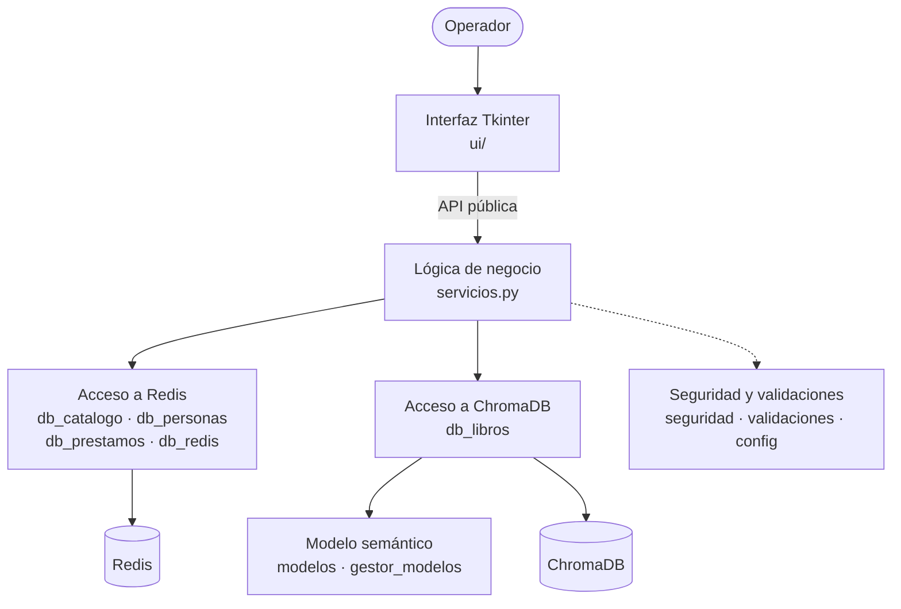
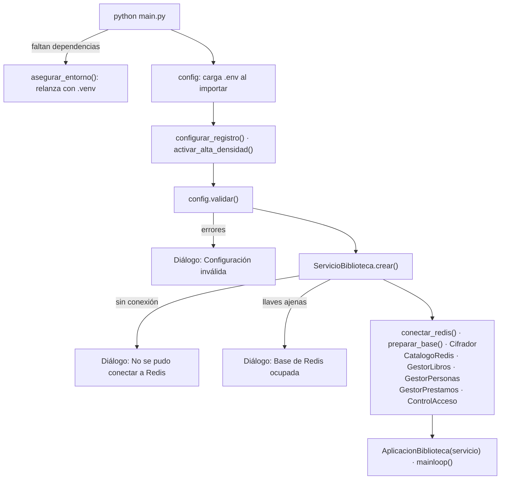
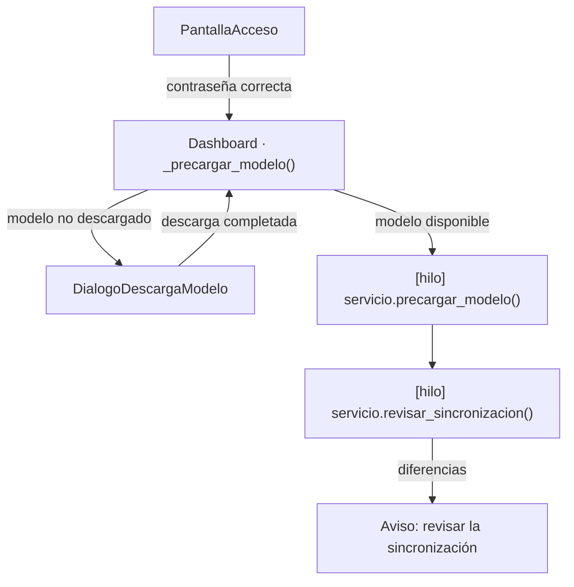
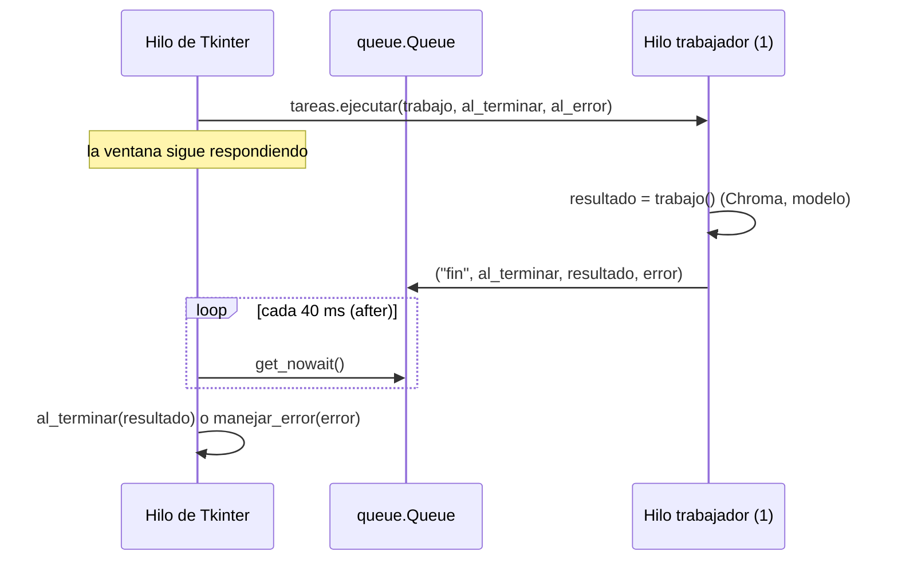

# Guía técnica para colaboradores

**Administrador de Préstamos de Libros** · Python + Tkinter + Redis + ChromaDB + Qwen3-Embedding-0.6B

Manual de referencia para cualquier persona que se incorpore al desarrollo. Todo lo descrito corresponde al código del repositorio. Cuando algo no existe o no se ha verificado, se indica expresamente.

| Documento relacionado | Contenido |
|---|---|
| [ARQUITECTURA.md](ARQUITECTURA.md) | Capas, dependencias, modelo de datos y consistencia (Anexo A). |
| [FLUJOS_DATOS.md](FLUJOS_DATOS.md) | Recorrido de cada funcionalidad con diagramas de secuencia (Anexo B). |
| [MODELO_SEMANTICO.md](MODELO_SEMANTICO.md) | Modelo de embeddings, descarga y búsqueda (Anexo C). |
| [SEGURIDAD.md](SEGURIDAD.md) | Cifrado, llaves, control de acceso y LFPDPPP (Anexo D). |
| [INTEGRACION.md](../INTEGRACION.md) | Contrato de la API entre interfaz y backend (Anexo E). |
| [INSTALACION.md](INSTALACION.md) | Instalación en Windows paso a paso (Anexo F). |
| [CONTRIBUCION.md](CONTRIBUCION.md) | Git, GitHub y normas de desarrollo (Anexo G). |
| [MANTENIMIENTO.md](MANTENIMIENTO.md) | Diagnóstico y solución de problemas (Anexo H). |

---

## 1. Introducción general

### 1.1 Propósito y problema que resuelve

Una biblioteca necesita saber qué libros tiene, quién los tiene prestados y desde cuándo, y localizar un libro aunque el usuario no recuerde el título exacto. Este sistema resuelve cuatro problemas:

- **Control del acervo**: catálogo con validación de datos (incluido el dígito de control del ISBN), importación masiva y estado de cada ejemplar.
- **Usuarios y préstamos**: registro de personas y préstamos de hasta 3 libros por persona, con fecha límite, devoluciones e historial permanente.
- **Búsqueda por significado**: el usuario describe lo que busca («un náufrago que sobrevive solo en una isla») y el sistema encuentra los libros cuyas sinopsis se parecen en significado, aunque no compartan palabras.
- **Protección de datos personales**: los datos de las personas se guardan cifrados y se muestran parcialmente ocultos, con funciones para los derechos ARCO.

### 1.2 Objetivos académicos

El proyecto pertenece a la materia de Bases de Datos NoSQL. Demuestra:

- El uso de un **almacén clave-valor** (Redis) con estructuras HASH, SET, ZSET, LIST y STRING, transacciones optimistas e índices secundarios.
- El uso de una **base de datos vectorial** (ChromaDB) para la búsqueda semántica.
- La integración de un **modelo de embeddings** multilingüe ejecutado localmente.
- La **coordinación de dos bases de datos** sin transacción distribuida, mediante compensación.
- Buenas prácticas de **seguridad**, **arquitectura en capas**, **pruebas automatizadas** y **trabajo colaborativo** con Git y GitHub.

### 1.3 Funcionalidades

| Área | Funcionalidades |
|---|---|
| Dashboard | Indicadores (libros, disponibles, prestados, personas, préstamos activos, vencidos e históricos), actividad reciente, próximos vencimientos y accesos rápidos. |
| Libros | Catálogo con filtros y ordenamiento, ficha con portada, alta, importación por lote (CSV o JSON), edición, eliminación y «Buscar similares». Portadas desde Open Library o desde una imagen del equipo. |
| Buscar libros | Búsqueda semántica en lenguaje natural, con opción «solo disponibles». |
| Personas | Alta con aviso de privacidad, búsqueda, rectificación, ficha ARCO, exportación a JSON y cancelación. |
| Préstamos | Préstamo de 1 a 3 libros; devolución de uno, varios o todos; historial. |
| Personas con préstamos | Vista agrupada con el contacto oculto, que se revela durante 20 segundos. |
| Configuración | Modelo (descarga, cambio y reindexado, tokens), sincronización Redis ↔ Chroma, seguridad, sistema, datos de ejemplo y descarga de las portadas que faltan. |

### 1.4 Tecnologías

| Tecnología | Versión probada | Papel |
|---|---|---|
| Python | 3.14.6 (mínimo 3.10) | Lenguaje de todo el sistema. |
| Tkinter / ttk | Tk 8.6 | Interfaz de escritorio. |
| Redis | Servidor 8.10.1; cliente `redis` 8.1.0 | Fuente de verdad: libros, personas, préstamos y bitácora. |
| ChromaDB | 1.5.9 | Base vectorial: sinopsis, embeddings y búsqueda. |
| sentence-transformers / transformers / torch | 6.1.0 / 5.20.2 / 2.14.1 | Ejecución del modelo de embeddings. |
| Qwen3-Embedding-0.6B | Revisión `97b0c614…` | Modelo que convierte texto en vectores de 1024 dimensiones. |
| huggingface_hub | 1.33.0 | Descarga del modelo. |
| cryptography | 50.0.2 | AES-256-GCM y HKDF. |
| Pillow | 12.3.0 | Validación y conversión de las portadas (solo en el backend). |
| Open Library | API pública | Fuente opcional de portadas, sin clave. |
| pytest + fakeredis | 9.2.0 / 2.40.0 | Pruebas automatizadas. |

### 1.5 Arquitectura y responsabilidades



| Capa | Responsabilidad | Puede llamar a |
|---|---|---|
| Interfaz (`ui/`) | Mostrar, capturar y avisar. **No accede a bases de datos.** | Solo la API pública de `ServicioBiblioteca`. |
| Lógica de negocio (`servicios.py`) | Reglas, coordinación y compensación entre bases, estadísticas, API pública. | Todas las capas inferiores. |
| Acceso a Redis | Llaves, transacciones, cifrado de campos. | Redis, `seguridad`, `validaciones`. |
| Acceso a ChromaDB | Documentos, metadatos, embeddings y consultas. | ChromaDB y el modelo. |
| Modelo semántico | Carga, descarga, validación e inferencia. | sentence-transformers y Hugging Face Hub. |
| Seguridad y validaciones | Reglas de datos, cifrado, autenticación y configuración. | Biblioteca estándar y `cryptography`. |

Detalle completo en el **Anexo A** ([ARQUITECTURA.md](ARQUITECTURA.md)).

---

## 2. Estructura del proyecto

### 2.1 Árbol de directorios

```text
Administrador-Prestamos-Libros/
├── main.py                     [fuente]   Punto de entrada
├── config.py                   [fuente]   Configuración y validación
├── validaciones.py             [fuente]   Reglas de libros y personas
├── seguridad.py                [fuente]   Cifrado, llaves, contraseña, aviso de privacidad
├── modelos.py                  [fuente]   Catálogo de modelos y carga
├── gestor_modelos.py           [fuente]   Descarga y validación de modelos
├── modelo_simulado.py          [fuente]   Modelo falso para pruebas y demostración
├── db_redis.py                 [fuente]   Conexión, llaves y bitácora (Redis)
├── db_catalogo.py              [fuente]   Libros en Redis
├── db_personas.py              [fuente]   Personas cifradas en Redis
├── db_prestamos.py             [fuente]   Préstamos en Redis
├── db_libros.py                [fuente]   Índice semántico en ChromaDB
├── servicios.py                [fuente]   Lógica de negocio y API pública
├── portadas.py                 [fuente]   Portadas: archivos locales y Open Library
├── demo_interfaz.py            [script]   Interfaz con datos en memoria
├── verificar.py                [script]   Diagnóstico del entorno
├── gestionar_modelos.py        [script]   CLI de modelos
├── gestionar_secretos.py       [script]   CLI de llave y contraseña
├── evaluar_busqueda.py         [script]   Métricas de búsqueda
├── comparar_modelos.py         [script]   Comparación de dos modelos
├── ui/                         [fuente]   Interfaz Tkinter
│   ├── app.py · acceso.py · descarga_modelo.py · tareas.py
│   ├── componentes.py · tema.py · iconos.py · __init__.py
│   └── vistas/  base.py · dashboard.py · libros.py · busqueda.py · personas.py
│                prestamos.py · personas_prestamos.py · configuracion.py · __init__.py
├── tests/                      [pruebas]  13 archivos, 151 pruebas
├── datos/                      [datos]    3 CSV (200 libros) + consultas_evaluacion.json
├── docs/                       [docs]     Esta documentación y sus PDF
│   └── herramientas/           [script]   Generador de PDF
├── .github/                    [config]   CI, plantillas, CODEOWNERS
├── requirements.txt · .env.example · docker-compose.yml · .gitignore · .gitattributes   [config]
├── README.md · CONTRIBUTING.md · INTEGRACION.md · PRUEBAS.md · ANALISIS_PROYECTO.md
├── GITHUB_PUBLICACION.md · LICENSE                                                       [docs]
│
│   Generados en cada equipo, excluidos de Git:
├── .env                        [local]    Configuración propia
├── secrets/                    [secreto]  biblioteca_aes.key, operador.hash
├── clave.key                   [secreto]  Llave heredada (solo en el equipo original)
├── chroma_db/                  [generado] Base de ChromaDB
├── portadas/                   [generado] Portadas ({id}.jpg + {id}.json)
├── modelo_activo.txt           [generado] Modelo activo (si se cambió)
├── biblioteca.log              [generado] Registro técnico
└── .venv/  __pycache__/        [generado]
```

### 2.2 Backend

| Archivo | Propósito y responsabilidades | Clases y funciones principales | Depende de | Precauciones |
|---|---|---|---|---|
| `config.py` | Lee `.env` y las variables de entorno; valores por defecto; validación. | `validar()`, `advertencias()`; constantes `REDIS_*`, `CHROMA_PATH`, `DIR_SECRETOS`, `MODELO_POR_DEFECTO`, `DIR_MODELOS`, `PERMITIR_DESCARGA_MODELOS`, `MAX_LIBROS_POR_PERSONA=3`, `DIAS_PRESTAMO`… | dotenv | Toda variable nueva debe documentarse en `.env.example` y validarse aquí. |
| `validaciones.py` | Reglas y normalización de datos. | `validar_libro`, `validar_persona`, `isbn_valido`, `normalizar_isbn`, `calcular_edad`, `normalizar_texto`, `clave_natural`; listas `ESTADOS_MEXICO`, `GENEROS_PERSONA`, `OCUPACIONES`, `TIPOS_USUARIO`, `TIPOS_PASTA`; `CAMPOS_LIBRO`, `CAMPOS_PERSONA`. | — | Cambiar una regla afecta a la importación de los CSV de ejemplo. |
| `seguridad.py` | Cifrado de campos, llaves, contraseña del operador, enmascaramiento y aviso de privacidad. | `Cifrador` (`cifrar`, `descifrar`, `hash_indice`, `es_heredado`), `ControlAcceso`, `cargar_llave_maestra`, `hash_contrasena`, `verificar_contrasena`, `enmascarar_correo`, `enmascarar_telefono`, `AVISO_PRIVACIDAD`. | config, cryptography | No cambies las etiquetas HKDF ni el formato `v2:`: los datos existentes se volverían ilegibles. |
| `modelos.py` | Catálogo de modelos (revisión, licencia, dimensión) y envoltura de sentence-transformers. | `MODELOS`, `ModeloEmbeddings` (`embeber_documentos`, `embeber_consulta`, `contar_tokens`, `liberar`), `nombre_coleccion`, `resolver_dispositivo`, `ModeloNoDisponible`. | config, gestor_modelos | No modifiques `revision` ni `dim` de una clave existente (ver el capítulo 6). |
| `gestor_modelos.py` | Disponibilidad local, descarga con progreso y validación. | `estado`, `esta_descargado`, `ruta_local`, `plan_descarga`, `descargar`, `validar`; `ErrorDescarga`, `SinConexion`, `EspacioInsuficiente`. | config, modelos, huggingface_hub | Usa siempre la revisión fijada. |
| `modelo_simulado.py` | Embeddings deterministas por palabras (64 dimensiones). | `ModeloSimulado`, `fabrica_simulada`. | validaciones | Solo para pruebas y demostración. |
| `db_redis.py` | Conexión, espacio de nombres y bitácora. | `conectar_redis`, `preparar_base`, `Llaves`, `RegistroActividad`, `ErrorBaseOcupada`, `marca_tiempo`. | config, redis | Toda llave nueva se define en `Llaves`. |
| `db_catalogo.py` | Libros en Redis. | `CatalogoRedis` (`guardar`, `guardar_lote`, `obtener`, `obtener_varios`, `listar`, `eliminar`, `restaurar`, `dueno_isbn`, `contar_disponibles`). | db_redis, validaciones | `guardar` es una transacción `WATCH`; respeta el índice `idx:isbn`. |
| `db_personas.py` | Personas con campos cifrados. | `GestorPersonas` (`registrar`, `actualizar`, `obtener`, `listar`, `buscar`, `eliminar`, `exportar_datos`, `migrar_cifrado_heredado`), `PersonaNoEncontrada`. | db_redis, seguridad, validaciones | Nunca guardes datos personales sin cifrar. |
| `db_prestamos.py` | Préstamos con historial. | `GestorPrestamos` (`prestar`, `devolver`, `activos_de`, `historial_de`, `activo_de_libro`, `activos`, `cupo_disponible`…). | config, db_redis | Las transacciones vigilan muchas llaves; añade aquí cualquier llave nueva relacionada. |
| `db_libros.py` | Índice semántico en ChromaDB. | `GestorLibros` (`agregar`, `actualizar`, `actualizar_metadatos`, `eliminar`, `obtener`, `restaurar`, `buscar`, `cambiar_modelo`…), `leer_modelo_activo`, `metadatos_de`. | config, modelos, validaciones, chromadb | Los embeddings los calcula la aplicación (`embedding_function=None`). |
| `portadas.py` | Portadas: validación con Pillow, archivos `{id}.jpg` y `{id}.json`, búsqueda en Open Library por ISBN y por título. | `AlmacenPortadas` (`guardar`, `quitar`, `info`, `miniatura_png`, `ids`), `ClienteOpenLibrary` (`buscar`), `normalizar_imagen`, `titulos_compatibles`, `ErrorPortada`. | config, validaciones, Pillow | No guardes imágenes en Redis ni en ChromaDB. Respeta la pausa entre peticiones a Open Library. |
| `servicios.py` | Lógica de negocio, compensación y API pública. | `ServicioBiblioteca` (más de 40 métodos públicos), `describir_error`, `leer_archivo_libros`, `ResultadoLote`, `InformeSincronizacion`. | todos los anteriores | Es el **contrato** con la interfaz: todo cambio se refleja en [INTEGRACION.md](../INTEGRACION.md) y en `tests/test_api_interfaz.py`. |
| `main.py` | Arranque, registro técnico, errores de inicio. | `main`, `asegurar_entorno`, `configurar_registro`, `activar_alta_densidad`, `error_de_arranque`. | config, servicios, ui.app | Las importaciones posteriores a `asegurar_entorno()` llevan `# noqa: E402` a propósito. |

### 2.3 Interfaz (`ui/`)

| Archivo | Propósito | Clases y funciones |
|---|---|---|
| `app.py` | Ventana principal, menú lateral, navegación, errores, bloqueo, precarga del modelo. | `AplicacionBiblioteca` (`navegar`, `manejar_error`, `bloquear`, `ofrecer_descarga`, `mensaje_estado`, `actualizar_modelo`, `cerrar`), `BotonLateral`, `SECCIONES`. |
| `acceso.py` | Pantalla de acceso y diálogo de cambio de contraseña (solo presentación). | `PantallaAcceso`, `CambioContrasena`, `dibujar_logo`. |
| `descarga_modelo.py` | Diálogo de descarga del modelo con progreso. | `DialogoDescargaModelo`. |
| `tareas.py` | Hilo trabajador y cola hacia Tkinter. | `GestorTareas` (`ejecutar`, `en_interfaz`, `progreso`, `cerrar`). |
| `componentes.py` | Componentes reutilizables. | `Boton`, `Tabla`, `Formulario`, `Dialogo`, `Notificador`, `Indicador`, `Ayuda`, `Portada`; `informar`, `confirmar`, `tarjeta`, `caja_texto`, `escribir`, `centrar`, `cabecera_dialogo`, `encabezado_tarjeta`. |
| `tema.py` | Paleta (`COLOR`), tipografías y estilos ttk; escala para alta densidad. | `aplicar_tema`, `px`, `f`, `ft`, `fm`, `ESCALA`. |
| `iconos.py` | Iconos de Segoe Fluent Icons con respaldo Unicode. | `GLIFOS`, `RESPALDO`, `glifo`, `fuente`. |
| `vistas/base.py` | Clase base de las secciones y utilidades. | `Vista` (`construir`, `al_mostrar`, `refrescar`, `tarea`, `exito`, `aviso`, `accion`), `contenido_ficha`, `fecha_corta`, `etiqueta_estado`. |
| `vistas/*.py` | Las 7 secciones. | `VistaDashboard`, `VistaLibros`, `VistaBusqueda`, `VistaPersonas` (+ `FichaPersona`), `VistaPrestamos`, `VistaPersonasConPrestamo`, `VistaConfiguracion`. |

**Precaución**: la interfaz solo puede usar la API pública del servicio (capítulo 8 e [INTEGRACION.md](../INTEGRACION.md)); `tests/test_arquitectura.py` lo verifica. `ui/tareas.py` y partes de `ui/app.py` requieren coordinarse con el backend ([CONTRIBUTING.md](../CONTRIBUTING.md)).

### 2.4 Scripts, pruebas, datos y configuración

| Archivo | Uso |
|---|---|
| `verificar.py` | Diagnóstico completo del entorno. |
| `gestionar_modelos.py` | `estado`, `descargar [clave]`, `validar [clave]`. |
| `gestionar_secretos.py` | `estado`, `contrasena`, `nueva-llave`. |
| `demo_interfaz.py` | Interfaz con fakeredis y Chroma en memoria: `crear_servicio_demo`, `cargar_datos_demo`; opciones `--modelo-real` y `--sin-datos`. |
| `evaluar_busqueda.py` / `comparar_modelos.py` | Evaluación de la calidad de búsqueda y comparación entre modelos. |
| `tests/conftest.py` | Fixtures: `redis_falso` (fakeredis), `cifrador`, `indice` (Chroma temporal + modelo simulado), `servicio`, `libro_ejemplo`, `persona_ejemplo`. |
| `tests/test_*.py` | Validaciones, seguridad, personas, libros, préstamos, API, arquitectura, configuración, gestor de modelos, demostración, interfaz e integración real. |
| `datos/*.csv` | 200 libros de ejemplo (75 originales con los ISBN corregidos + 125 nuevos). |
| `datos/consultas_evaluacion.json` | 60 consultas etiquetadas. |
| `.github/workflows/pruebas.yml` | Integración continua: Ubuntu, Python 3.12, PyTorch para CPU, `pytest`. |
| `.github/CODEOWNERS` | Revisores automáticos por área. |
| `docker-compose.yml` | Redis opcional con persistencia y contraseña opcional. |

---

## 3. Arquitectura y ejecución

### 3.1 Arranque paso a paso

**Del comando a la ventana:**



**Después del acceso:**



1. **Punto de entrada**: `python main.py`. Si al ejecutar el archivo faltan dependencias, `asegurar_entorno()` relanza el programa con el Python de `.venv`.
2. **Configuración**: al importar `config`, se cargan `.env` (si existe) y las variables de entorno con sus valores por defecto. También se definen variables de entorno de Hugging Face y Chroma que desactivan la telemetría.
3. **Registro técnico**: `biblioteca.log`, con rotación a 1 MB.
4. **Validación**: `config.validar()` detiene el arranque con un diálogo si hay valores inválidos.
5. **Servicios**: `ServicioBiblioteca.crear()` conecta con Redis (`conectar_redis` + `PING`), comprueba la base (`preparar_base`), crea el `Cifrador` (llave maestra y llave heredada), abre ChromaDB (`PersistentClient`) y la colección del modelo activo, y crea los gestores y el `ControlAcceso`. **El modelo no se carga todavía**: la carga es perezosa.
6. **Interfaz**: `AplicacionBiblioteca` aplica el tema, calcula el tamaño de la ventana, construye el menú lateral y la barra de estado, crea el `GestorTareas` y el `Notificador`, programa la revisión de inactividad cada 30 s y muestra la `PantallaAcceso`.
7. **Ciclo principal**: `mainloop()` procesa los eventos. Cada 40 ms, `GestorTareas._revisar` vacía la cola de resultados del hilo trabajador y ejecuta los *callbacks* en el hilo de Tkinter.
8. **Tras el acceso**: se muestra el Dashboard y se precarga el modelo en el hilo trabajador; si falta, se ofrece descargarlo. Al terminar se revisa la sincronización entre Redis y Chroma y, si hay diferencias, aparece un aviso.

### 3.2 Variables de entorno

La lista completa, con valores por defecto, está en [INSTALACION.md](INSTALACION.md#6-archivo-de-configuración-env) y en `.env.example`. Las variables que lee el código son: `REDIS_HOST`, `REDIS_PORT`, `REDIS_DB`, `REDIS_PASSWORD`, `REDIS_USUARIO`, `REDIS_SSL`, `REDIS_PREFIJO`, `REDIS_TIMEOUT`, `BIBLIOTECA_CHROMA_PATH`, `BIBLIOTECA_DIR_SECRETOS`, `BIBLIOTECA_MODELO`, `BIBLIOTECA_DIR_MODELOS`, `BIBLIOTECA_PERMITIR_DESCARGA`, `BIBLIOTECA_DISPOSITIVO`, `BIBLIOTECA_LOTE_EMBEDDINGS`, `BIBLIOTECA_DIAS_PRESTAMO`, `BIBLIOTECA_MINUTOS_BLOQUEO`, `BIBLIOTECA_DIR_PORTADAS`, `BIBLIOTECA_DESCARGAR_PORTADAS`, `BIBLIOTECA_AES_KEY`, `BIBLIOTECA_OPERADOR_HASH` y `BIBLIOTECA_KEY` (llave heredada). Las pruebas usan además `BIBLIOTECA_PRUEBAS_REALES`. `REDIS_BIND` solo la usa `docker-compose.yml`.

### 3.3 Modelo de hilos



Con un solo trabajador, las operaciones con ChromaDB y el modelo **nunca se ejecutan en paralelo**. Las descargas del modelo usan un hilo independiente para no bloquear esa cola.

Diagramas de secuencia completos de cada operación: **Anexo B** ([FLUJOS_DATOS.md](FLUJOS_DATOS.md)).

---

## 4. Redis

Redis es la **fuente de verdad** del sistema. Usa una base dedicada (`REDIS_DB`, 2 por defecto) y todas las llaves llevan el prefijo `REDIS_PREFIJO` (`bib:`), construidas por `db_redis.Llaves`.

| Estructura | Llaves | Por qué ese tipo |
|---|---|---|
| HASH | `libro:{id}`, `persona:{id}`, `prestamo:{id}` | Un registro con campos con nombre; lectura completa con `HGETALL` y actualización de campos con `HSET`. |
| SET | `libros`, `personas`, `prestamos:activos`, `persona:{id}:prestamos_activos`, `personas_con_prestamo`, `sync:pendientes` | Colecciones sin duplicados; pertenencia y conteo con `SISMEMBER`/`SCARD` en O(1). |
| ZSET | `persona:{id}:historial`, `prestamos:todos` | Historial ordenado por fecha (el *score* es el timestamp). |
| STRING | `idx:isbn:{isbn}`, `idx:correo:{hmac}`, `libro:{id}:prestamo_activo`, `persona:contador`, `prestamo:contador`, `meta:esquema` | Índices de unicidad (`SET NX`), contadores (`INCR`) y marcadores. |
| LIST | `actividad` | Bitácora: `LPUSH` + `LTRIM 0 99`. |

**Ejemplo ilustrativo** (préstamo de *Harry Potter*, `libro09`, a `P0001`; las fechas son de ejemplo):

```text
HGETALL bib:prestamo:PR000001
  id PR000001 · persona_id P0001 · libro_id libro09 · titulo "Harry Potter y la piedra filosofal"
  autor "J. K. Rowling" · fecha_prestamo 2026-11-19T10:00:00 · fecha_limite 2026-12-03
  fecha_devolucion "" · estado activo
GET bib:libro:libro09:prestamo_activo         → PR000001
HGET bib:libro:libro09 disponible             → 0
SMEMBERS bib:persona:P0001:prestamos_activos  → {PR000001, …}
```

- **Identificadores**: `libroNN` (los define el usuario y deben cumplir `RE_ID_LIBRO`); `P0001` y `PR000001`, generados con `INCR`.
- **Transacciones**: `CatalogoRedis.guardar`, `GestorPrestamos.prestar` y `GestorPrestamos.devolver` usan `r.transaction(funcion, *llaves_vigiladas)`, que se reintenta si otra conexión modifica una llave vigilada (`WATCH`/`MULTI`/`EXEC`).
- **Manejo de errores**: los errores de conexión se propagan hasta la interfaz y `describir_error` los presenta como «Sin conexión con Redis». Si falla la escritura de la bitácora, se registra un aviso y la operación principal no se interrumpe.
- **Persistencia**: depende de la configuración del servidor (RDB o AOF). Con Docker Compose: AOF en el volumen `redis_datos`.

Tabla completa de llaves y diagrama entidad-relación: **Anexo A**, sección 4.

---

## 5. ChromaDB

| Elemento | Implementación |
|---|---|
| Cliente | `chromadb.PersistentClient(path=CHROMA_PATH, settings=Settings(anonymized_telemetry=False))` |
| Colección | `libros_<clave_modelo>` (por ejemplo `libros_qwen3_embedding_0_6b`), una por modelo |
| Configuración | `{"hnsw": {"space": "cosine"}}`; metadatos de la colección `{"modelo", "dimensiones"}` |
| `ids` | Id del libro (el mismo que en Redis) |
| `documents` | Sinopsis |
| `metadatas` | Los 12 campos de `CAMPOS_METADATOS_LIBRO` (isbn, titulo, autor, anio, editorial, genero, tema, idioma, pasta, paginas, calificacion, disponible) |
| `embeddings` | Calculados por `ModeloEmbeddings`; `embedding_function=None` |

**Operaciones** (`GestorLibros`):

| Método | Operación de Chroma |
|---|---|
| `agregar` | `upsert` en lotes de 32 |
| `actualizar` | `update` con o sin embedding nuevo |
| `actualizar_metadatos` | `get` + `update` (disponibilidad) |
| `eliminar` | `delete` |
| `obtener` | `get` (opcionalmente con el embedding) |
| `restaurar` | `upsert` desde una copia |
| `buscar` | `query`, con `similitud = 1 − distancia` |
| `todos` / `ids` / `contar` | `get` / `count` |
| `cambiar_modelo` | Reindexa en otra colección |

**Relación con Redis**: comparten el `id`. Redis manda sobre los metadatos y la disponibilidad; Chroma guarda una copia para identificar los documentos. La búsqueda siempre completa sus resultados con Redis. Si las bases se desincronizan, Configuración › Sincronización detecta y repara las diferencias.

**Persistencia**: la carpeta `chroma_db/` guarda la base en disco. `tests/test_config.py` comprueba que otro proceso puede leer lo escrito.

---

## 6. Modelo semántico

| Dato | Valor |
|---|---|
| Modelo | `Qwen/Qwen3-Embedding-0.6B`, revisión `97b0c614be4d77ee51c0cef4e5f07c00f9eb65b3`, licencia Apache-2.0 |
| Vector | 1024 dimensiones, normalizado (coseno) |
| Ubicación | `BIBLIOTECA_DIR_MODELOS` o la caché de Hugging Face; solo se usa si está la revisión fijada completa |
| Carga | Perezosa, siempre local (`local_files_only=True`); float16 en GPU y float32 en CPU |
| Consultas | Con la instrucción «Given a web search query, retrieve relevant passages…» |
| Descarga | Ofrecida por la aplicación o con `python gestionar_modelos.py descargar`; ~1.2 GB; se reanuda y se valida |
| Recursos medidos | ~1.12 GB de VRAM cargado; pico de 1.74 GB al indexar |

> **Advertencia sobre dimensiones.** Cada modelo tiene su propia colección. No cambies la `revision` ni la `dim` de una clave existente, y no mezcles vectores de modelos distintos. Para cambiar de modelo usa **Configuración › Modelo semántico › Usar el modelo seleccionado y reindexar**.

Descripción completa (descarga paso a paso, búsqueda, errores, calidad medida y modelos alternativos): **Anexo C** ([MODELO_SEMANTICO.md](MODELO_SEMANTICO.md)).

---

## 7. Seguridad

| Medida | Implementación |
|---|---|
| Cifrado de datos personales | AES-256-GCM por campo, con AAD `persona:{id}:{campo}`; formato `v2:` + base64 |
| Llaves | Llave maestra de 256 bits (`BIBLIOTECA_AES_KEY` o `secrets/biblioteca_aes.key`) → HKDF-SHA256 → llave de cifrado y llave del índice |
| Unicidad del correo | Índice ciego HMAC-SHA256 + `SET NX` |
| Operador | Contraseña con hash scrypt; espera de 30 s tras 5 fallos; bloqueo por inactividad |
| Minimización | Correo y teléfono enmascarados; búsqueda sin datos de contacto; registro sin datos personales |
| ARCO | Ficha, exportación a JSON, rectificación y cancelación; consentimiento obligatorio |
| Servicios externos | La búsqueda de portadas envía a Open Library solo el ISBN, el título y el autor del libro, nunca datos de personas; se desactiva con `BIBLIOTECA_DESCARGAR_PORTADAS=0` |
| Secretos fuera de Git | `.gitignore` excluye `.env`, `secrets/`, `*.key`, `chroma_db/`, `portadas/`; GitHub tiene activados el escaneo de secretos y la protección al subir cambios |

**Implementado** frente a **pendiente**: la rotación de llaves con datos existentes, las cuentas por operador, la bitácora de consultas de fichas, el procedimiento para menores de edad y el aviso de privacidad integral **no están implementados**. Detalle completo y aspectos de la LFPDPPP en el **Anexo D** ([SEGURIDAD.md](SEGURIDAD.md)).

---

## 8. Interfaz Tkinter

### 8.1 Estructura

- **Ventana**: `AplicacionBiblioteca(tk.Tk)` contiene el menú lateral (`BotonLateral` por cada elemento de `SECCIONES`), el contenedor de vistas y la barra de estado (mensaje, barra de progreso indeterminada y `descripcion_conexion()`).
- **Vistas**: cada sección es una subclase de `Vista` (`ttk.Frame`) que se crea la primera vez que se visita (`_crear_vista`) y se muestra con `pack` / `pack_forget`.
- **Navegación**: `app.navegar(clave, **contexto)` muestra la vista y llama a `vista.al_mostrar(**contexto)`. El contexto permite saltar entre secciones con datos; por ejemplo, `navegar("prestamos", persona_id="P0001", libro_id="libro09")` o `navegar("busqueda", consulta=sinopsis, excluir=id)`.
- **Diálogos**: `Formulario` (modal, con errores en línea), `Dialogo`, `informar` y `confirmar` (modales), `FichaPersona`, `DialogoDescargaModelo`, `CambioContrasena`.
- **Tablas**: `Tabla` (ttk.Treeview) con orden natural al pulsar la cabecera, reparto proporcional del ancho, mensaje cuando no hay filas y modo árbol (`cargar_arbol`).
- **Avisos**: `Notificador.mostrar(texto, tipo)` muestra un aviso breve en la esquina, que desaparece solo.

### 8.2 Eventos, *callbacks* y validaciones

- Los botones (`Boton`) invocan su `comando` al hacer clic o al pulsar `Enter` o `Espacio`.
- Las tablas emiten `<<TreeviewSelect>>` y `<Double-1>`.
- Los filtros de texto usan `<KeyRelease>` con una espera de 200–250 ms (`after`) antes de filtrar.
- Los formularios llaman a `al_guardar(datos, formulario)`. Si se lanza `ValueError`, el formulario muestra los errores en línea y no se cierra. Las reglas reales están en el backend (`validar_libro` y `validar_persona`).
- Cualquier excepción no controlada en un *callback* llega a `report_callback_exception`, que la registra y la muestra con `manejar_error`.
- La actividad del usuario (teclado, ratón) reinicia el temporizador de bloqueo por inactividad.

### 8.3 Tareas lentas y comunicación con los servicios

```python
# Patrón usado en las vistas (ui/vistas/busqueda.py, simplificado)
self.tarea(lambda: self.servicio.buscar_libros(texto, 10, solo),   # en el hilo trabajador
           listo,                                                 # en el hilo de Tkinter
           "Buscando por significado…",                           # barra de estado
           fallo)                                                 # opcional
```

Todo lo que toque ChromaDB o el modelo va en `self.tarea`. Las operaciones que solo usan Redis pueden llamarse directamente. La tabla completa de la API, con el hilo recomendado, las excepciones y los ejemplos, está en el **Anexo E** ([INTEGRACION.md](../INTEGRACION.md)).

### 8.4 Procedimiento para agregar una vista nueva

1. **Crea** `ui/vistas/mi_vista.py`:
   ```python
   from ui.componentes import Tabla, tarjeta
   from ui.vistas.base import Vista

   class VistaMiVista(Vista):
       titulo = "Mi vista"
       subtitulo = "Descripción breve."

       def construir(self):
           self.accion("Actualizar", "refrescar", self.refrescar)
           caja = tarjeta(self.cuerpo, 12)
           caja.pack(fill="both", expand=True)
           self.tabla = Tabla(caja, [("id", "ID", 80), ("titulo", "Título", 300)],
                              mensaje_vacio="Sin datos.")
           self.tabla.pack(fill="both", expand=True)

       def refrescar(self):
           self.tarea(self.servicio.catalogo_libros, self.tabla.cargar, "Cargando…")
   ```
2. **Registra** la vista en `ui/app.py`: añade `("mi_vista", "Mi vista", "<icono>")` a `SECCIONES` (el icono debe existir en `ui/iconos.GLIFOS`) y la clase al diccionario de `_crear_vista`.
3. **Usa solo la API pública** del servicio. Si necesitas datos nuevos, pide un método al backend ([CONTRIBUTING.md](../CONTRIBUTING.md)).
4. **Prueba** con `python demo_interfaz.py` y añade la sección a `test_navegacion_por_todas_las_secciones` en `tests/test_interfaz.py`.
5. **Verifica** con `python -m pytest tests/test_arquitectura.py tests/test_interfaz.py`.

---

## 9. Funcionalidades

| Funcionalidad | Vista y método | Servicio | Redis | ChromaDB |
|---|---|---|---|---|
| Alta de libro | `VistaLibros.alta` | `validar_alta`, `alta_libro` | `HSET libro`, `SADD libros`, `SET idx:isbn` (WATCH) | `upsert` + embedding |
| Importación por lote | `VistaLibros.importar` | `importar_archivo` → `importar_lote` | `guardar_lote` (MULTI) | `upsert` en lotes de 32 |
| Catálogo | `VistaLibros.refrescar` | `catalogo_libros`, `filtrar_catalogo`, `obtener_libro` | `SMEMBERS` + `HGETALL`, préstamos activos | `get` (sinopsis de la ficha) |
| Búsqueda semántica | `VistaBusqueda.buscar` | `buscar_libros` | `obtener_varios` (estado) | `query` |
| Actualización | `VistaLibros.editar` | `actualizar_libro` | `guardar(nuevo=False)` | `update` (con o sin embedding) |
| Eliminación | `VistaLibros.eliminar` | `eliminar_libro` | `DEL libro`, `SREM`, `DEL idx:isbn` | `delete` |
| Alta de persona | `VistaPersonas.alta` | `registrar_persona` | `INCR`, `SET NX idx:correo`, `HSET` cifrado | — |
| Actualización de persona | `VistaPersonas.editar` | `actualizar_persona` | `HSET` cifrado, `HSETNX fecha_aviso`, índice del correo | — |
| Catálogo de personas | `VistaPersonas.refrescar` | `buscar_personas`, `contar_personas` | `SMEMBERS`, `HGETALL`, `SCARD` | — |
| Préstamo | `VistaPrestamos.prestar` | `prestar` | Transacción WATCH/MULTI | `update` de la disponibilidad |
| Devolución | `VistaPrestamos.devolver` / `devolver_todos` | `devolver` | Transacción WATCH/MULTI | `update` de la disponibilidad |
| Personas con préstamos | `VistaPersonasConPrestamo.refrescar` | `personas_con_prestamos` | `SMEMBERS prestamos:activos`, `HGETALL` | — |
| Portadas | `VistaLibros.elegir_portada` / `buscar_portada` / `quitar_portada`; `VistaConfiguracion.descargar_portadas` | `asignar_portada`, `buscar_portada`, `quitar_portada`, `descargar_portadas`, `portada_libro` | Solo lectura del libro | — (archivos en `portadas/`) |

Recorrido paso a paso con diagramas de secuencia: **Anexo B** ([FLUJOS_DATOS.md](FLUJOS_DATOS.md)).

---

## 10. Instalación y configuración

Resumen para Windows; los comandos completos y la solución de problemas están en el **Anexo F** ([INSTALACION.md](INSTALACION.md)).

```powershell
git clone https://github.com/vesseldot/Administrador-Prestamos-Libros.git
cd Administrador-Prestamos-Libros
git switch develop
python -m venv .venv
.\.venv\Scripts\Activate.ps1
pip install torch --index-url https://download.pytorch.org/whl/cpu    # o el índice de tu CUDA
pip install -r requirements.txt
copy .env.example .env               # ajustar REDIS_HOST, REDIS_PORT, REDIS_DB…
redis-cli ping                       # tu Redis local → PONG
redis-cli -n 2 DBSIZE                # → 0
python verificar.py
python main.py                       # o: python demo_interfaz.py  (sin Redis ni GPU)
```

---

## 11. Construcción y distribución

- **No existe un ejecutable** (no hay configuración de PyInstaller ni de otro empaquetador). La aplicación se distribuye como código fuente desde GitHub y se ejecuta con Python dentro de un entorno virtual.
- **Dependencias**: `requirements.txt`, con PyTorch instalado aparte según el hardware.
- **Archivos necesarios**: todos los versionados en Git. Cada equipo genera en su primer uso `.env`, `secrets/`, `chroma_db/`, `portadas/` y la descarga del modelo. Las portadas no se versionan porque tienen derechos de sus editoriales.
- **Recursos**: la fuente de iconos Segoe Fluent Icons es del sistema Windows y no se distribuye; en otros sistemas se usan símbolos Unicode. Los datos de ejemplo están en `datos/`.
- **Modelo**: no se distribuye con el repositorio; se descarga desde Hugging Face en la revisión fijada (Apache-2.0).
- **Integración continua**: `.github/workflows/pruebas.yml` instala las dependencias en Ubuntu con PyTorch para CPU y ejecuta las pruebas en cada `push` y Pull Request hacia `main` o `develop`. Las pruebas que requieren pantalla, Redis o el modelo real se omiten allí.
- **Documentación**: los PDF de `docs/` se generan con `python docs/herramientas/generar_pdf.py` (requiere pandoc, Chrome o Edge, y `pypdf`; ver `docs/herramientas/LEEME.md`).

---

## 12. Git y GitHub

| Elemento | Configuración |
|---|---|
| Repositorio | <https://github.com/vesseldot/Administrador-Prestamos-Libros> (público, MIT) |
| Ramas | `main` (estable) y `develop` (integración), protegidas contra *force push* y borrado; ramas de trabajo `feature/*`, `fix/*`, `docs/*`, `chore/*` |
| Integración | `git push` directo permitido a quien tenga escritura; Pull Request recomendado para cambios grandes |
| Revisores | `CODEOWNERS`: @miasmee para `ui/` y `tests/test_interfaz.py`; @vesseldot para el resto |
| Commits | *Conventional Commits* en español |

Comandos, revisión de Pull Requests, conflictos y sincronización: **Anexo G** ([CONTRIBUCION.md](CONTRIBUCION.md)). Roles y archivos por área: [CONTRIBUTING.md](../CONTRIBUTING.md).

---

## 13. Normas de desarrollo

- **PEP 8**, con un máximo de 120 caracteres por línea; nombres en español; importaciones ordenadas.
- **Sin comentarios redundantes**: solo docstrings útiles y directivas `# noqa`.
- **Excepciones**: `ValueError` con un mensaje para el usuario en los errores corregibles. Los errores del sistema se propagan hasta `describir_error`. No se captura `Exception` sin registrar el error ni sin el `# noqa: BLE001`.
- **Validaciones** en el backend (`validaciones.py`); la interfaz no puede ser la única validación.
- **Pruebas** para cada cambio (`tests/`) y `python -m pytest tests` antes de cada commit.
- **Seguridad**: sin secretos en el código y sin datos personales en registros o mensajes.
- **Separación**: la interfaz solo usa la API pública del servicio.

Detalle en el **Anexo G**, sección 6.

---

## 14. Mantenimiento

| Área | Primer paso |
|---|---|
| Entorno completo | `python verificar.py` |
| Python y dependencias | `python -c "import sys; print(sys.executable)"` |
| Redis | `redis-cli -h HOST -p PUERTO ping`, `redis-cli -n 2 --scan --pattern "bib:*"` |
| ChromaDB | Configuración › Sincronización › Revisar |
| Modelo | `python gestionar_modelos.py estado` / `validar` |
| Cifrado y secretos | `python gestionar_secretos.py estado` |
| Interfaz | `biblioteca.log` y `python demo_interfaz.py` |
| Portadas | Configuración › Sistema › Portadas de los libros |
| Configuración | Los mensajes de `config.validar()` |
| Git | `git status`, `git fetch origin` |

Tablas de diagnóstico completas: **Anexo H** ([MANTENIMIENTO.md](MANTENIMIENTO.md)).

---

## 15. Glosario

| Término | Definición en el contexto del proyecto |
|---|---|
| **AAD** | *Additional Authenticated Data*: datos que AES-GCM autentica sin cifrar. Aquí, `persona:{id}:{campo}`. |
| **AES-256-GCM** | Cifrado simétrico autenticado con llave de 256 bits; detecta alteraciones. |
| **API pública** | Métodos de `ServicioBiblioteca` que la interfaz puede usar ([INTEGRACION.md](../INTEGRACION.md)). |
| **ARCO** | Derechos de Acceso, Rectificación, Cancelación y Oposición sobre los datos personales. |
| **Colección** | Conjunto de documentos y vectores de ChromaDB; aquí hay una por modelo. |
| **Compensación** | Deshacer el paso anterior cuando falla una operación que toca dos bases. |
| **Distancia coseno** | Medida de diferencia entre vectores; `similitud = 1 − distancia`. |
| **Embedding** | Vector numérico que representa el significado de un texto (1024 números con Qwen). |
| **fakeredis** | Implementación de Redis en memoria para pruebas y demostración. |
| **Fernet** | Formato de cifrado del esquema anterior (solo lectura). |
| **HASH, SET, ZSET, LIST, STRING** | Estructuras de datos de Redis. |
| **HKDF** | Función que deriva llaves independientes a partir de una llave maestra. |
| **HMAC / índice ciego** | Huella con llave de un dato; permite buscar duplicados sin guardar el dato en claro. |
| **HNSW** | Índice de vecinos aproximados que usa ChromaDB para buscar vectores rápido. |
| **Hugging Face Hub** | Repositorio público de modelos de donde se descarga Qwen. |
| **Hilo trabajador** | Hilo único de `GestorTareas` que ejecuta el trabajo pesado. |
| **Last-token pooling** | Usar el estado del último token como resumen del texto (método de Qwen). |
| **LFPDPPP** | Ley Federal de Protección de Datos Personales en Posesión de los Particulares (México). |
| **Open Library** | Catálogo bibliográfico abierto (openlibrary.org) del que se pueden descargar portadas sin clave. |
| **Portada** | Imagen del libro guardada como archivo `portadas/{id}.jpg`; no forma parte de Redis ni de ChromaDB. |
| **Prefijo** | Texto (`bib:`) al inicio de todas las llaves de la aplicación en Redis. |
| **Revisión fijada** | Commit exacto del modelo en Hugging Face; garantiza los mismos pesos para todos. |
| **scrypt** | Función de hash de contraseñas resistente a ataques por fuerza bruta. |
| **Sinopsis** | Resumen del libro; es el texto que se convierte en embedding. |
| **Tarea** | Trabajo enviado al hilo trabajador con `self.tarea(...)`. |
| **Token** | Unidad de texto que procesa el modelo; el límite es de 512. |
| **WATCH/MULTI/EXEC** | Transacción optimista de Redis: se cancela y se reintenta si cambian las llaves vigiladas. |
