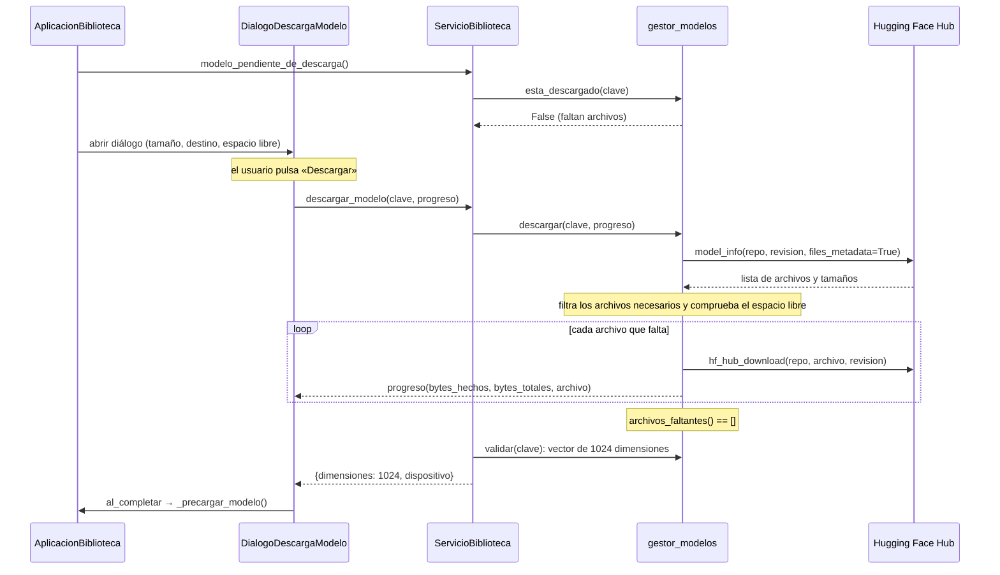

# Modelo semántico

Este documento describe el modelo de embeddings que hace posible la búsqueda por significado: qué es, de dónde se obtiene, cómo se descarga, carga y usa, cuántos recursos consume y qué puede fallar.

## 1. Identificación

| Dato | Valor | Fuente |
|---|---|---|
| Clave interna | `qwen3-embedding-0.6b` | `modelos.MODELOS` |
| Repositorio | `Qwen/Qwen3-Embedding-0.6B` (Hugging Face Hub, público, sin restricciones de acceso) | `modelos.MODELOS` y la API del Hub |
| Revisión fijada | `97b0c614be4d77ee51c0cef4e5f07c00f9eb65b3` | `modelos.MODELOS["qwen3-embedding-0.6b"]["revision"]` |
| Licencia | Apache-2.0 (del modelo, distinta de la licencia MIT del proyecto) | Metadatos del Hub |
| Dimensión del vector | **1024** | `1_Pooling/config.json` (`word_embedding_dimension: 1024`) y prueba `validar()` |
| Agregación | *Last-token pooling* con normalización L2 | `1_Pooling/config.json` (`pooling_mode_lasttoken: true`) y `modules.json` (`Normalize`) |
| Capas del transformador | 28 (tamaño oculto 1024) | `config.json` del modelo (`num_hidden_layers`, `hidden_size`) |
| Longitud usada | 512 tokens (`max_tokens`) | `modelos.MODELOS` → `max_seq_length` |
| Tamaño en disco | 1207.5 MB (`model.safetensors` 1191.6 MB) | Lista de archivos de la revisión (`plan_descarga`) |

Según su ficha pública, el modelo admite más de 100 idiomas, contextos largos y «instrucciones» en las consultas. El proyecto **no usa** la reducción de dimensiones (MRL) que también ofrece: siempre trabaja con 1024 dimensiones.

## 2. Librerías y dependencias

| Paquete | Uso |
|---|---|
| `sentence-transformers` | Carga el modelo (`SentenceTransformer`) y genera vectores (`encode`). |
| `transformers` y `torch` | Ejecución del modelo, en GPU con CUDA o en CPU. |
| `huggingface_hub` | Consulta de la revisión (`HfApi.model_info`), descarga (`hf_hub_download`) y localización en la caché (`try_to_load_from_cache`). |
| `chromadb` | **No** genera embeddings: solo los guarda y los compara (`embedding_function=None`). |

## 3. Modelo y ChromaDB: qué hace cada uno

| Tarea | Responsable |
|---|---|
| Convertir texto en un vector de 1024 números | **Modelo** (`ModeloEmbeddings.embeber_documentos` y `embeber_consulta`) |
| Guardar vectores junto a su documento y sus metadatos | **ChromaDB** (`coleccion.upsert`) |
| Encontrar los vectores más cercanos a la consulta (índice HNSW, distancia coseno) | **ChromaDB** (`coleccion.query`) |
| Convertir la distancia en similitud y completar los datos con Redis | **Servicios** (`GestorLibros.buscar` y `ServicioBiblioteca.buscar_libros`) |

## 4. Ubicación, caché y reutilización

- **Carpeta**: `BIBLIOTECA_DIR_MODELOS` o, si está vacía, la caché estándar de Hugging Face (`~/.cache/huggingface/hub`; en Windows, `C:\Users\<usuario>\.cache\huggingface\hub`). Se consulta con `gestor_modelos.directorio_modelos()`.
- **Estructura**: `models--Qwen--Qwen3-Embedding-0.6B/snapshots/<revisión>/…`. `ruta_local(clave)` devuelve esa carpeta **solo si** contiene todos los archivos de `MODELOS[clave]["archivos"]`.
- **Reutilización**: si otro proyecto ya descargó la misma revisión en la caché de Hugging Face, la aplicación la usa sin volver a descargarla.
- **Archivos necesarios** para Qwen: `config.json`, `modules.json`, `model.safetensors`, `1_Pooling/config.json`, `tokenizer.json`, `tokenizer_config.json` y `config_sentence_transformers.json`. La descarga trae además `vocab.json`, `merges.txt` y `generation_config.json`.

## 5. Descarga inicial paso a paso



1. **Comprobación**: `esta_descargado` busca cada archivo necesario en la caché, en la revisión fijada (`try_to_load_from_cache`).
2. **Plan**: `plan_descarga` pide al Hub la lista de archivos de esa revisión exacta y descarta los innecesarios (`PATRONES_EXCLUIDOS`: `onnx/*`, `openvino/*`, `*.onnx`, `*.h5`, `*.msgpack`, `*.bin`, `*.csv`, `.gitattributes`). Si falta algún archivo obligatorio, lanza `ErrorDescarga`.
3. **Espacio**: exige el espacio de lo que falta por bajar más 300 MB (`MARGEN_ESPACIO_BYTES`); si no lo hay, lanza `EspacioInsuficiente`.
4. **Descarga**: `hf_hub_download` baja cada archivo pendiente. El progreso se obtiene con una barra `tqdm` propia (`_clase_progreso`) que informa los bytes. Si la descarga se interrumpe, al reintentar solo se bajan los archivos que faltan.
5. **Verificación**: al terminar, `archivos_faltantes()` debe estar vacío.
6. **Validación**: `validar()` carga el modelo, genera un vector de prueba y comprueba que mida 1024.

**Por terminal**: `python gestionar_modelos.py estado | descargar [clave] | validar [clave]`.

**Medición real**: en la verificación de la fase 11 se descargaron 1207.5 MB en 1010 s (1.2 MB/s con la conexión de prueba). La segunda ejecución detectó el modelo y no volvió a descargar nada (1 s).

## 6. Carga e inferencia

```python
# modelos.py — ModeloEmbeddings._cargar (código real)
def _cargar(self):
    from gestor_modelos import ruta_local
    ruta = ruta_local(self.clave)
    if ruta is None:
        raise ModeloNoDisponible(...)                      # mensaje con instrucciones de descarga
    from sentence_transformers import SentenceTransformer
    argumentos = {}
    if self.info["media_precision"] and self.dispositivo == "cuda":
        import torch
        argumentos["model_kwargs"] = {"dtype": torch.float16}
    modelo = SentenceTransformer(str(ruta), device=self.dispositivo, local_files_only=True, **argumentos)
    modelo.max_seq_length = self.info["max_tokens"]
    return modelo
```

- **Carga perezosa**: el modelo se carga la primera vez que se accede a `ModeloEmbeddings.modelo`, protegido por un `threading.Lock`. La aplicación fuerza esa carga al iniciar sesión con `precargar_modelo()` (un embedding de «calentamiento»).
- **Dispositivo**: `resolver_dispositivo()` usa `BIBLIOTECA_DISPOSITIVO` (`auto`, `cuda` o `cpu`). Con `auto` elige CUDA si `torch.cuda.is_available()`.
- **Precisión**: float16 en GPU (`media_precision=True` para Qwen); float32 en CPU.
- **Siempre local**: se carga desde la carpeta de la revisión fijada con `local_files_only=True`. **Nunca descarga de forma implícita.**
- **Documentos**: `embeber_documentos(textos)` codifica las sinopsis sin instrucción, en lotes de `BIBLIOTECA_LOTE_EMBEDDINGS` (32 por defecto), con `normalize_embeddings=True`.
- **Consultas**: `embeber_consulta(texto)` antepone la instrucción `Instruct: Given a web search query, retrieve relevant passages that answer the query\nQuery:` (`INSTRUCCION_POR_DEFECTO`). Los modelos e5 usan en su lugar los prefijos `passage:` y `query:`.
- **Tokens**: `contar_tokens(texto)` usa el tokenizador del modelo. Con Qwen, la sinopsis más larga del catálogo ocupa 147 tokens, muy por debajo del límite de 512.

## 7. Búsqueda semántica paso a paso

1. El usuario escribe «sociedad donde se queman libros».
2. `VistaBusqueda.buscar` llama a `self.tarea(lambda: self.servicio.buscar_libros(texto, cantidad, solo))`.
3. `ServicioBiblioteca.buscar_libros` pide a `GestorLibros.buscar` el triple de candidatos si solo se quieren disponibles.
4. `GestorLibros.buscar` genera el vector de la consulta (1024 números) y ejecuta `coleccion.query(query_embeddings=[…], n_results=…, include=["documents", "metadatas", "distances"])`.
5. ChromaDB busca en el índice HNSW los vectores con menor **distancia coseno**.
6. Cada resultado se convierte en `similitud = round(1 - distancia, 4)`.
7. El servicio completa cada candidato con los datos de Redis (`catalogo.obtener_varios`), calcula el estado (Disponible, Prestado o No disponible) y descarta los que ya no existen en Redis.
8. La interfaz muestra la tabla con la similitud en porcentaje y la ficha del libro.

## 8. Calidad medida

Medida con `evaluar_busqueda.py`, sobre 200 libros y 60 consultas etiquetadas:

| Modelo | Acierto en 1.ª posición | Acierto en el top 3 | MRR | Consulta media |
|---|---:|---:|---:|---:|
| **Qwen3-Embedding-0.6B** (instrucción genérica, la que se usa) | 90 % | 100 % | 0.944 | 44 ms |
| Qwen3-Embedding-0.6B (instrucción específica para libros) | 88 % | 97 % | 0.926 | 51 ms |
| paraphrase-multilingual-MiniLM-L12-v2 | 82 % | 92 % | 0.864 | 12 ms |

Detalle en [PRUEBAS.md](../PRUEBAS.md).

## 9. Recursos medidos

| Recurso | Valor | Observación |
|---|---|---|
| Disco | ~1.2 GB por modelo descargado | La caché puede compartirse con otros proyectos. |
| VRAM | 1.12 GB con el modelo cargado en float16 | Medición del equipo de desarrollo (RTX 4060 Laptop). |
| VRAM pico al indexar | 1.74 GB | Indexando 200 sinopsis en lotes de 32 (`evaluar_busqueda.py`). |
| Carga inicial | ~2–15 s | La primera vez, con el disco frío, tardó más. |
| CPU | Sin medir | El código usa float32 en CPU; su rendimiento **no se midió**. |

## 10. Funcionamiento sin conexión

- Una vez descargado, el modelo funciona **sin Internet**: la carga es siempre local.
- `BIBLIOTECA_PERMITIR_DESCARGA=0` impide cualquier descarga: el diálogo deshabilita el botón y la terminal lo informa.
- Si se define la variable estándar `HF_HUB_OFFLINE=1`, la descarga falla, y `gestor_modelos._clasificar` la convierte en `SinConexion` con instrucciones.

## 11. Errores y cómo se presentan

| Excepción | Cuándo | Mensaje al usuario (`describir_error`) |
|---|---|---|
| `ModeloNoDisponible` | Se intenta usar un modelo que no está descargado. | «Modelo no disponible» + cómo descargarlo. |
| `SinConexion` | No hay acceso a huggingface.co, o `HF_HUB_OFFLINE` está activo. | «Descarga del modelo» + revisar la conexión o el proxy. |
| `EspacioInsuficiente` | El disco no tiene el espacio necesario. | Espacio necesario y disponible, o usar `BIBLIOTECA_DIR_MODELOS`. |
| `ErrorDescarga` | Descarga incompleta, revisión sin archivos o modelo que no carga. | Detalle del fallo. |

## 12. Compatibilidad de dimensiones: advertencias

> **Advertencia.** Los vectores de modelos distintos **no son comparables**. Una colección creada con un modelo de 1024 dimensiones no acepta vectores de 384, y aunque coincidiera la dimensión, mezclar modelos daría resultados sin sentido.

- Cada modelo tiene **su propia colección** (`libros_<clave>`), y su dimensión queda registrada en los metadatos de la colección.
- Para cambiar de modelo usa siempre **Configuración › Modelo semántico › Usar el modelo seleccionado** (`ServicioBiblioteca.cambiar_modelo`). La colección del modelo conserva lo que ya procesó: compara por sinopsis y solo calcula los vectores de los libros nuevos o con la sinopsis editada, reutiliza el resto y elimina los que ya no existen. Cada colección anota la revisión del modelo en sus metadatos; si no coincide, recalcula todos los vectores una vez. Solo cambia de modelo si todo salió bien, y si se interrumpe, el siguiente intento continúa donde quedó.
- **No cambies** la `revision`, el `nombre_completo` ni la `dim` de una clave existente en `MODELOS`. Si necesitas otro modelo, **agrega una clave nueva**.
- El modelo simulado (`modelo_simulado.py`, 64 dimensiones) solo se usa en pruebas y en la demostración, siempre con bases en memoria o temporales.

## 13. Modelos alternativos del catálogo

| Clave | Repositorio | Dim. | Tokens | Licencia | Tamaño | ¿Probado aquí? |
|---|---|---:|---:|---|---|---|
| `paraphrase-multilingual-MiniLM-L12-v2` | sentence-transformers/… | 384 | 128 | Apache-2.0 | ~500 MB | Sí (evaluación) |
| `multilingual-e5-small` | intfloat/… | 384 | 512 | MIT | ~490 MB | No (no descargado) |
| `multilingual-e5-base` | intfloat/… | 768 | 512 | MIT | ~1.1 GB | No (no descargado) |
| `sentence_similarity_spanish_es` | hiiamsid/… | 768 | 512 | Apache-2.0 | ~440 MB | No (no descargado) |
