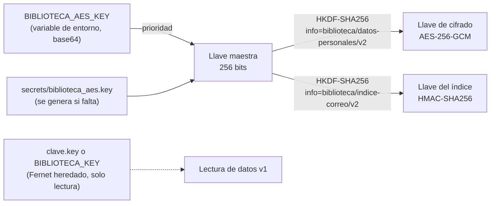
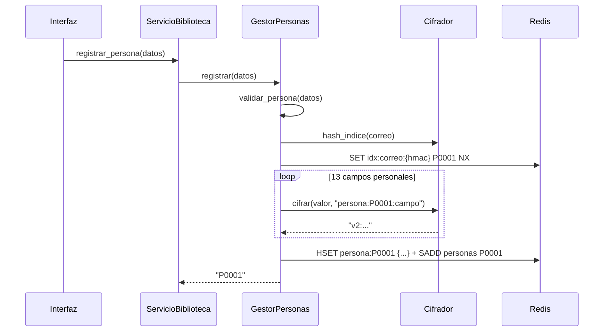

# Seguridad y protección de datos personales

> **Advertencia.** Este documento describe **medidas técnicas**. Implementar cifrado y controles de acceso **no basta para afirmar que el sistema cumple la LFPDPPP**. El cumplimiento depende también de medidas administrativas, físicas y de procedimientos del responsable, que deben revisarse con asesoría legal (sección 8).

## 1. Datos que se tratan

| Dato | Clasificación | Almacenamiento |
|---|---|---|
| Nombre, apellidos, fecha de nacimiento, género, correo, teléfono, domicilio (calle y número, colonia, ciudad, estado, C.P.), ocupación | Personales | Cifrados por campo en Redis (`db_personas.CAMPOS_CIFRADOS`). |
| Tipo de usuario (Alumno, Profesor o Externo) | Personal no identificativo, necesario para filtrar | En claro (`CAMPOS_CLAROS`). |
| Edad | Derivada | **No se almacena**: `calcular_edad` la calcula al leer. |
| Aceptación del aviso y sus fechas | Prueba del consentimiento | En claro. |
| Catálogo de libros | Público | Redis y Chroma, sin cifrar. |

No se recaban datos personales sensibles. El catálogo y los datos personales están separados: **ChromaDB solo contiene información de libros**.

## 2. Gestión de llaves



- `seguridad.cargar_llave_maestra()` toma la llave de `BIBLIOTECA_AES_KEY` o de `secrets/biblioteca_aes.key`. Si no existe ninguna, genera 32 bytes aleatorios con `secrets.token_bytes` y los guarda en base64, abriendo el archivo con permisos `0o600`. En Windows ese modo tiene un efecto limitado; ver los riesgos.
- `_decodificar_llave` rechaza llaves que no sean base64 válido o que no midan 32 bytes (`ErrorLlave`). `config.validar()` hace la misma comprobación al arrancar si la llave viene de la variable de entorno.
- **HKDF-SHA256** (`_derivar`) obtiene dos llaves independientes, de modo que la misma llave nunca se usa para dos propósitos.
- La llave heredada (`clave.key` o `BIBLIOTECA_KEY`, Fernet) **solo se lee** (`cargar_llave_legada`) para descifrar datos del esquema anterior; no se modifica.
- La carpeta de secretos es configurable con `BIBLIOTECA_DIR_SECRETOS` (por defecto `secrets/`).

## 3. Cifrado y descifrado de campos

**Algoritmo**: AES-256-GCM (`cryptography.hazmat.primitives.ciphers.aead.AESGCM`), un cifrado autenticado. Cada valor usa un *nonce* aleatorio de 96 bits (`LONGITUD_NONCE = 12`).

**Formato almacenado**: `v2:` + base64url(nonce ‖ texto cifrado ‖ etiqueta de autenticación).

**Datos asociados (AAD)**: `persona:{id}:{campo}`, construidos por `GestorPersonas._contexto`. El AAD no se cifra, pero queda «firmado». Si alguien copia el teléfono cifrado de una persona en el campo de otra, o intercambia dos campos, la etiqueta no coincide y el descifrado falla.



```python
# seguridad.py — Cifrador.cifrar (código real)
def cifrar(self, texto: str, contexto: str) -> str:
    nonce = os.urandom(LONGITUD_NONCE)
    cifrado = self._aes.encrypt(nonce, str(texto).encode("utf-8"), contexto.encode("utf-8"))
    return PREFIJO_TOKEN + _b64(nonce + cifrado)
```

**Descifrado** (`Cifrador.descifrar`):

- Si el valor empieza por `v2:`, se separan el *nonce* y el texto cifrado y se descifra con el mismo AAD. Si la etiqueta no coincide, lanza `ErrorCifrado`.
- Si no empieza por `v2:` y existe una llave heredada, se intenta descifrar como Fernet.
- `GestorPersonas._descifrar` captura `ErrorCifrado`: deja ese campo vacío y marca `integridad_ok = False`, sin interrumpir la lectura. La interfaz pinta la fila en rojo y la ficha muestra un aviso.

## 4. Índice ciego del correo

Se guarda un **HMAC-SHA256** del correo normalizado (en minúsculas y sin espacios), con la llave del índice. Permite detectar correos duplicados **sin guardar el correo en claro y sin descifrar a todas las personas**. La reserva usa `SET NX`, así que dos altas simultáneas no pueden quedarse con el mismo correo.

## 5. Control de acceso

- **Contraseña de operador**: se guarda solo como hash **scrypt** (`hashlib.scrypt`, N=2¹⁵, r=8, p=1, sal aleatoria de 16 bytes, 32 bytes de salida) en el formato `scrypt$N$r$p$sal$hash`, y se compara en tiempo constante (`hmac.compare_digest`).
- **Origen del hash**: `BIBLIOTECA_OPERADOR_HASH` o `secrets/operador.hash`.
- **Lógica**: está en `seguridad.ControlAcceso`, en el backend. Tras **5 intentos fallidos** (`MAX_INTENTOS_ACCESO`) el acceso queda en espera **30 segundos** (`SEGUNDOS_ESPERA_TRAS_FALLOS`). `crear_contrasena` y `cambiar_contrasena` exigen al menos 8 caracteres.
- **Bloqueo automático**: tras `BIBLIOTECA_MINUTOS_BLOQUEO` minutos (15 por defecto) de inactividad, y con el botón «Bloquear sesión». La pantalla de bloqueo cubre la ventana y cierra los diálogos abiertos (`AplicacionBiblioteca.bloquear`).
- **Cambio de contraseña**: desde **Configuración › Seguridad** o con `python gestionar_secretos.py contrasena`.
- **Redis**: admite contraseña (`REDIS_PASSWORD`), usuario ACL (`REDIS_USUARIO`) y TLS (`REDIS_SSL=1`).

## 6. Minimización, registro y derechos ARCO

### Minimización y visualización
- En los listados, el correo y el teléfono aparecen enmascarados (`enmascarar_correo`: `an***@correo.mx`; `enmascarar_telefono`: `******4567`).
- En «Personas con préstamos», el contacto se revela solo para la persona seleccionada y durante 20 segundos (`SEGUNDOS_VISIBLE`).
- La búsqueda de personas solo usa id, nombre completo, tipo, ocupación, ciudad y estado (`db_personas.CAMPOS_BUSQUEDA`). **No se busca por correo ni por teléfono.**

### Registro de eventos
- La bitácora (`bib:actividad`) y el archivo `biblioteca.log` guardan **solo identificadores** (P0001, libro09, PR000001), nunca nombres, correos ni teléfonos.
- Los errores inesperados se registran con su tipo y su traza técnica, sin incluir valores de campos.

### Derechos ARCO y consentimiento

| Derecho | Implementación |
|---|---|
| Consentimiento | Casilla obligatoria. `validar_persona` rechaza el alta si no se acepta el aviso. La fecha de aceptación (`fecha_aviso`) no se sobrescribe al rectificar (`HSETNX`). |
| Acceso | Ficha completa con el historial de préstamos (`FichaPersona`) y **exportación a JSON** (`exportar_persona`). |
| Rectificación | Edición validada; registra `fecha_actualizacion`. |
| Cancelación | `eliminar_persona` borra el registro y el índice del correo. Se bloquea si hay préstamos activos. El historial de préstamos se conserva **solo con el identificador** (seudonimizado). |
| Oposición | Procedimiento administrativo en el mostrador; el sistema permite la cancelación. |

## 7. Integridad del sistema y secretos fuera de Git

- Redis usa una base dedicada con prefijo propio, y la aplicación **se niega a arrancar** si la base contiene llaves ajenas (`ErrorBaseOcupada`).
- Hay transacciones `WATCH/MULTI` en préstamos, compensación entre Redis y Chroma y reparación de la sincronización.
- Toda entrada se valida estrictamente: formatos, listas cerradas, longitudes máximas, ISBN con dígito de control y caracteres permitidos en los ids que forman parte de las llaves de Redis (`RE_ID_LIBRO`).
- **Cada instalación genera sus propios secretos.** `.gitignore` excluye `.env`, `secrets/`, `*.key`, `clave*` (salvo `*.py`), `*.pem`, `operador.hash`, `chroma_db/`, `portadas/`, los registros y los modelos. GitHub tiene activados el escaneo de secretos y la protección al subir cambios.

- **Portadas y servicios externos.** La búsqueda de portadas consulta Open Library enviando solo el ISBN, el título y el autor del libro, con un identificador de cliente genérico y sin datos de personas ni del equipo. Puede desactivarse con `BIBLIOTECA_DESCARGAR_PORTADAS=0`. Toda imagen, descargada o elegida por el operador, se valida con Pillow (formato, tamaño máximo de 15 MB, límite de píxeles) y se vuelve a codificar como JPEG antes de guardarse; el nombre del archivo es el id del libro validado, lo que impide escribir fuera de la carpeta.

### Respaldo y rotación de la llave
1. **Respalda `secrets/biblioteca_aes.key` fuera del equipo**, por ejemplo en un gestor de contraseñas. Sin ella, los datos personales son irrecuperables.
2. Para usar una variable de entorno en lugar del archivo, genera una llave con `python gestionar_secretos.py nueva-llave` y defínela en `BIBLIOTECA_AES_KEY`. Hazlo **antes** de registrar personas: cambiar la llave con datos existentes los vuelve ilegibles.
3. La rotación de una llave con datos existentes (descifrar con la anterior y volver a cifrar con la nueva) **no está implementada**. Solo existe la migración de Fernet a AES-GCM (`migrar_cifrado_heredado`).

### Riesgos que no cubre esta versión

| Riesgo | Situación | Recomendación |
|---|---|---|
| Redis sin contraseña ni TLS | Con Docker Compose, Redis se publica solo en `127.0.0.1`; con un Redis local depende de su configuración. Sin contraseña, cualquier proceso local puede leer la base, aunque los datos personales siguen cifrados. | Definir `REDIS_PASSWORD` y usar TLS (`REDIS_SSL=1`) si Redis está en otro equipo. |
| Persistencia de Redis | Depende de la configuración del servidor. Con Compose: volumen `redis_datos` con AOF. | Respaldar AOF o RDB periódicamente. |
| Secretos en disco | `secrets/` está en claro en el sistema de archivos. | Cifrado de disco (BitLocker), permisos restringidos o un gestor de secretos. |
| Un solo operador | No hay cuentas individuales ni roles. | Usuarios con roles y bitácora de accesos por operador. |
| Bitácora de consultas | Se registran altas y cambios, pero no cada consulta de una ficha. | Registrar los accesos a datos personales si la política interna lo exige. |
| Copias exportadas | El JSON de exportación ARCO queda en claro donde se guarde. | Entregarlo solo al titular y borrarlo después. |
| Datos de ChromaDB | Solo contiene datos del catálogo; no requiere cifrado. | — |

### Alternativas consideradas
- **Fernet** (esquema anterior): AES-128-CBC + HMAC. Es seguro, pero se migró a AES-256-GCM por la especificación y para ligar cada valor a su campo mediante AAD.
- **bcrypt o argon2**: adecuados para contraseñas; se eligió scrypt porque está en la biblioteca estándar de Python. Ninguno sirve para datos que hay que volver a leer.
- **Cifrar a toda la persona como un solo bloque**: más simple, pero impide verificar campo por campo y obliga a reescribirlo todo en cada cambio.

## 8. Aspectos legales que requieren revisión (LFPDPPP)

Lo siguiente **no** lo resuelve el software y debe validarse con el área jurídica responsable:

- **Aviso de privacidad**: el texto incluido (`seguridad.AVISO_PRIVACIDAD`) es un aviso *simplificado* de ejemplo. Faltan la identidad y el domicilio del responsable, el aviso integral, los medios para ejercer los derechos ARCO y la forma de comunicar cambios del aviso.
- **Plazos y procedimiento ARCO**: los plazos de respuesta, la identificación del titular y el registro de solicitudes deben ajustarse a la ley vigente (LFPDPPP publicada en el DOF el 20 de marzo de 2025) y a su reglamento.
- **Menores de edad**: la validación admite edades de 0 a 120 años y los alumnos pueden ser menores. El consentimiento de quien ejerce la patria potestad requiere un procedimiento que el sistema no implementa.
- **Conservación y supresión**: hay que definir cuánto se conserva el historial seudonimizado y los registros de personas inactivas, y el procedimiento de bloqueo previo a la supresión.
- **Responsable y encargados**: designar a la persona o al departamento de datos personales, documentar las medidas administrativas y físicas y capacitar al personal.
- **Vulneraciones**: definir cómo se notifica a los titulares ante una vulneración de seguridad.
- **Autoridad**: el aviso menciona a la Secretaría Anticorrupción y Buen Gobierno como autoridad de vigilancia según la ley de 2025. Debe confirmarse que esta referencia siga vigente.
